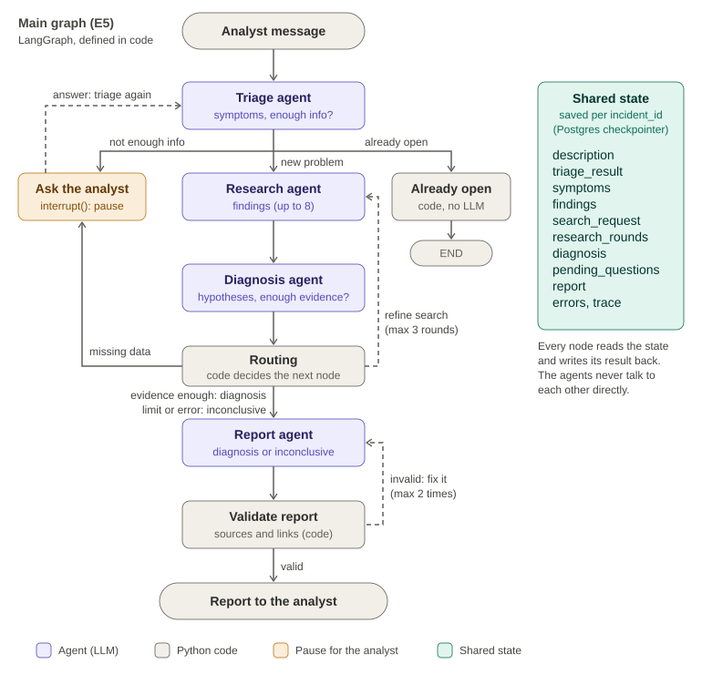

# Orquestração (E5)

O grafo principal que liga os agentes: **Triagem → Pesquisa → Diagnóstico → Relatório**, com o laço de nova busca,
a pausa para perguntar ao analista e a validação do relatório. O contrato (o que cada agente recebe e entrega) está
em [`docs/E5_Estado_e_Formatos.md`](../../docs/E5_Estado_e_Formatos.md).



## Arquivos

| Arquivo | O que é |
|---|---|
| `state.py` | o estado compartilhado (`InvestigationState`), os limites (`MAX_RESEARCH_ROUNDS = 3`, `MAX_REPORT_FIXES = 2`) e o serializador do checkpointer (`STATE_CLASSES`) |
| `graph.py` | os nós, o roteamento e `build_graph()` |
| `run.py` | a demonstração no terminal, com o estado salvo no Postgres |
| `tests/test_state.py` | o estado passa pelo checkpointer (pausa, retomada, classes Pydantic) |
| `tests/test_graph.py` | os 8 cenários do contrato com agentes falsos (sem modelo, sem banco) |
| `experiments/` | testes com o modelo real (Triagem → Pesquisa → Diagnóstico) e os relatórios em `experiments/results/` |

## Como o grafo funciona

```
START → triage ─┬─ falta informação ───► ask_analyst (pausa) ──► triage
                ├─ já existe ──────────► related_incident ──► END
                ├─ erro ───────────────► report (inconclusivo)
                └─ problema novo ──────► research ──► diagnosis ─┬─ evidência basta ──────────► report
                                            ▲                    ├─ nova busca (até 3 rodadas) ► research
                                            └────────────────────┤
                                                                 ├─ faltam dados ─────────────► ask_analyst
                                                                 └─ limite ou erro ───────────► report (inconclusivo)
report → validate_report ─┬─ ok ─────────────────► END
                          └─ problemas (até 2x) ─► report
```

- **Os agentes não conversam entre si.** Cada nó lê o que precisa do estado, chama o seu agente e escreve o resultado
  de volta. Quem decide o próximo passo é o roteamento, em código.
- **Pausa (`interrupt()`):** quando o Triagem ou o Diagnóstico precisa de dados do incidente, o grafo pausa com as
  perguntas e salva o estado no Postgres (`thread_id = incident_id`). A resposta pode vir na mesma execução ou depois,
  em outra.
- **Depois da resposta, a investigação recomeça** com a descrição enriquecida (Triagem de novo, busca do zero). No
  máximo 3 respostas por investigação (`MAX_ANALYST_ROUNDS`); depois disso, relatório inconclusivo.
- **Erros:** se um agente falhar depois das próprias tentativas (NIM fora do ar, respostas inválidas), o erro vai para
  `errors` e o grafo termina com relatório inconclusivo. Uma investigação sempre termina com uma resposta.
- **Passo a passo:** cada nó escreve uma linha em `trace` (nó, segundos, resumo), que a demo mostra.

## Rodar a demonstração

Da raiz do repositório, com o Docker ligado (o Postgres guarda o RAG e os checkpoints) e o `.env` com a chave do NIM:

```bash
# nova investigação (se houver perguntas, elas aparecem no terminal)
multiagent_env/bin/python -I agents/orchestration/run.py "Requests are failing across an entire region." --incident DEMO-1

# responder depois, em outra execução
multiagent_env/bin/python -I agents/orchestration/run.py --resume DEMO-1 "It is our cloud object store. An engineer took a handful of machines out..."

# ver onde uma investigação parou (passo a passo e perguntas pendentes, ou o relatório)
multiagent_env/bin/python -I agents/orchestration/run.py --show DEMO-1

# sem Postgres (o estado só existe enquanto o programa roda)
multiagent_env/bin/python -I agents/orchestration/run.py "..." --memory
```

Na primeira execução, o `run.py` cria as tabelas do checkpointer no banco. Tempo típico com o NIM gratuito: 2 a 3
minutos para um caso conhecido; uns 6 minutos para um caso fora do corpus (3 rodadas de busca). Os avisos
`429 (limite do NIM)` são normais: o `rag/limite_llm.py` espera e tenta de novo.

Exemplos (25/11):
- `DEMO-104`: mensagem vaga → o Triagem pergunta o serviço → pausa → retomada em outra execução → o Pesquisa
  aprofunda o post-mortem certo (DAN-104) → Diagnóstico `high` → relatório com a fonte e o link.
- `DEMO-NEW` (incidente inventado: pagamentos em dobro depois do horário de verão): 3 rodadas de busca sem caso
  parecido → pergunta ao analista ("o agendador trata 01:30 como um horário que acontece duas vezes?").

## Rodar os testes

```bash
PYTHONPATH=. multiagent_env/bin/python -m agents.orchestration.tests.test_graph   # 33 verificações, segundos
PYTHONPATH=. multiagent_env/bin/python -m agents.orchestration.tests.test_state   # 10 verificações
```

Os agentes são chamados pelas variáveis `graph.run_triage`, `graph.run_research` e `graph.run_diagnosis`; os testes
trocam essas variáveis por agentes falsos com respostas prontas.

## Para a Mari: ligar o Relatório e a validação

Enquanto o `agents/report` não existe, o grafo usa versões provisórias em código (`report_node`,
`validate_report_node` e `related_incident_node` em `graph.py`): o relatório é montado a partir das hipóteses do
Diagnóstico, sem LLM, no formato da seção 6 do contrato. Para usar os nós de verdade:

```python
from agents.orchestration.graph import build_graph
from agents.report.node import report_node, validate_report_node   # os nós da Mari

graph = build_graph(checkpointer, report=report_node, validate_report=validate_report_node)
```

O que os nós precisam respeitar:
- **`report`** lê `diagnosis`, `findings`, `errors`, `report_problems` (os problemas da validação anterior, quando
  houver) e escreve `report`. Com `diagnosis` ausente ou `evidence_sufficient = False`, o relatório é inconclusivo.
- **`validate_report`** escreve `report_problems` (lista vazia quando está tudo certo) e soma 1 em `report_attempts`
  quando há problemas. O roteamento volta ao `report` até `MAX_REPORT_FIXES` vezes.
- As classes Pydantic do relatório entram em `STATE_CLASSES` (`state.py`), senão o checkpointer não as lê de volta.
- O nó `related_incident` também é provisório: `build_graph(..., related_incident=seu_no)`.
- Quando o `agents/triage/node.py` passar a usar `description` e `symptoms`, o adaptador `_run_triage` em `graph.py`
  pode chamar o nó direto.
