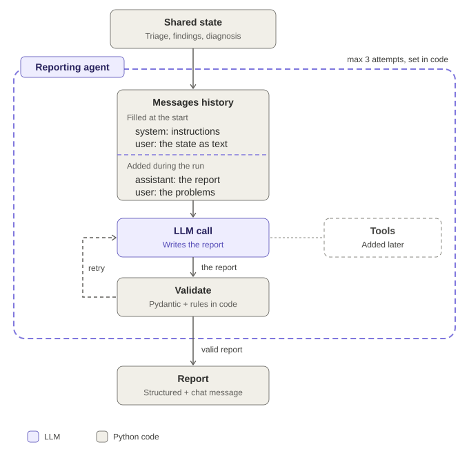

# Reporting agent

O último agente do Incident Copilot. Ele recebe o diagnóstico e as evidências e escreve a **resposta final
para o analista**: um diagnóstico com causa, correção, prevenção e link do post-mortem, ou um relatório
inconclusivo que explica o que faltou. Não diagnostica e não busca: apresenta o que os outros agentes
já encontraram.

É um LLM com um prompt, **sem ferramentas** (podem entrar depois) e com uma validação em código.

## O fluxo



A linha tracejada roxa marca o que está **dentro do agente**. A linha tracejada dentro da Messages history
separa o que é preenchido **no início** do que é adicionado **durante a execução**. Roxo é o LLM e cinza é
código Python. A caixa "Tools" tracejada ainda não existe: o agente não usa ferramentas por enquanto.

1. `build_user_message` transforma o estado em texto: a mensagem do analista, os sintomas, o tipo de relatório,
   as hipóteses do Diagnóstico e os incidentes passados (com link, resumo e trechos).
2. O LLM responde com um JSON: o `Report` estruturado e o campo `message`, o texto em Markdown que o
   frontend mostra no chat.
3. A resposta é validada. Se houver problemas, eles voltam ao modelo e ele corrige (no máximo 3 tentativas).

### Quem decide o quê

| Decide | O quê |
|---|---|
| **Código** | o tipo do relatório (`diagnosis` se a evidência basta, `inconclusive` se não), o `incident_id` e a validação |
| **LLM** | o texto: o resumo, os passos, o checklist e a mensagem final, no idioma do analista |

### Regras em código (`validation.py`)

| Regra | O que evita |
|---|---|
| o tipo do relatório é o que o diagnóstico pede | chamar de "inconclusivo" o que o Diagnóstico já deu como suficiente |
| toda fonte existe nos `findings`, com exatamente o `url` deles | links inventados |
| em um diagnóstico, as causas são as hipóteses do Diagnóstico: mesmo número, mesma ordem, mesma confiança, e cada uma cita os incidentes em que se baseia | o Reporting mudar o ranking ou a confiança |
| a mensagem só tem links dos `findings` e mostra o link de cada fonte | links falsos ou fontes escondidas |

## Incidente duplicado (`related.py`)

Quando o Triagem encontra uma investigação aberta com o mesmo problema, o grafo não chama o LLM: `related_incident_node`
monta em código a resposta "já em investigação", no mesmo formato dos outros relatórios (`summary` + `message` em
Markdown), no idioma do analista (português ou inglês, pelas palavras da mensagem), com o serviço, os sintomas e o que
fazer se não for o mesmo problema. Testes: `tests/test_related.py`.

## Estado incompleto

O agente tolera chaves ausentes no estado (um agente anterior falhou): sem `diagnosis`, devolve o relatório
inconclusivo em código sem chamar o modelo; `findings`, `triage_result` e campos dos achados ausentes contam como
vazios. Teste: caso 4 de `tests/test_node.py`.

## Entrada e saída

**Entrada:** o estado compartilhado, com as chaves `incident_id`, `description`, `triage_result`, `findings`
e `diagnosis` (nomes do `docs/E5_Estado_e_Formatos.md`).

**Saída:** um `Report` (`schema.py`):

| Campo | O que é |
|---|---|
| `incident_id` | o id da investigação; o código preenche |
| `kind` | `diagnosis` ou `inconclusive` |
| `summary` | 2 a 3 frases |
| `message` | a resposta para o chat, em Markdown, pronta para mostrar |
| `causes` | por causa: `root_cause`, `remediation_steps`, `changes`, `prevention_checklist`, `sources` e `confidence` |
| `gaps` | o que falta (obrigatório em `inconclusive`) |
| `suggested_checks` | o que o analista pode verificar agora |

`remediation_steps` e `prevention_checklist` podem ficar vazios: se o post-mortem que temos não diz como foi
corrigido, o agente deve dizer isso e não inventar.

## Arquivos

| Arquivo | Conteúdo |
|---|---|
| `schema.py` | o molde do `Report` (Pydantic) e a leitura da resposta do modelo |
| `validation.py` | as regras em código |
| `prompts.py` | as instruções do agente e a montagem do texto que o modelo lê |
| `agent.py` | `run_reporting_agent`: o laço com validação |
| `node.py` | `reporting_node`: o agente como nó do LangGraph |
| `related.py` | `related_incident_node`: a resposta para um incidente já em investigação (código) |
| `llm.py` | o cliente do modelo (o mesmo do Triagem; o modelo vem de `LLM_MODEL` no `.env`) |
| `tests/` | testes e entradas simuladas |

### Como usar como nó do grafo

```python
from agents.reporting.node import reporting_node

graph.add_node("reporting", reporting_node)
```

O nó lê o estado e escreve `report`, `report_attempts`, `report_problems` e `errors`.

## Como rodar os testes

Todos os comandos, a partir da **raiz do repositório**. Em Linux ou macOS, troque `.venv/Scripts/python.exe`
por `.venv/bin/python`.

### Sem o modelo (instantâneos)

```bash
.venv/Scripts/python.exe -m agents.reporting.tests.test_fixtures
.venv/Scripts/python.exe -m agents.reporting.tests.test_schema
.venv/Scripts/python.exe -m agents.reporting.tests.test_validation
.venv/Scripts/python.exe -m agents.reporting.tests.test_prompt
.venv/Scripts/python.exe -m agents.reporting.tests.test_agent_rules
.venv/Scripts/python.exe -m agents.reporting.tests.test_node
```

| Teste | O que confere |
|---|---|
| `test_fixtures` | as entradas simuladas estão bem formadas |
| `test_schema` | o Pydantic aceita relatórios bons e recusa os ruins |
| `test_validation` | as regras em código pegam um relatório desonesto |
| `test_prompt` | o texto que o modelo lê tem tudo o que precisa |
| `test_agent_rules` | o laço funciona quando o modelo erra (usa um modelo de mentira) |
| `test_node` | o nó funciona dentro de um grafo LangGraph de verdade |

### Com o modelo (precisa de `NVIDIA_API_KEY` no `.env` da raiz)

Todos os cenários, de 20 a 70 segundos cada:

```bash
.venv/Scripts/python.exe -m agents.reporting.tests.test_scenarios
```

Só um cenário (troque o nome):

```bash
.venv/Scripts/python.exe -m agents.reporting.tests.test_scenarios thin_passages_edge
```

Ver o agente por dentro, com a Messages history, o relatório estruturado e a mensagem para o chat:

```bash
.venv/Scripts/python.exe -m agents.reporting.tests.test_agent_loop gitlab_diagnosis_en
```

### Os cenários

As entradas ficam em `tests/fixtures/`. A evidência é texto real do corpus de post-mortems (GitLab,
Keepthescore, Spotify); as similaridades e os campos `why` foram inventados.

| Cenário | O que testa |
|---|---|
| `gitlab_diagnosis_en` | caso normal: evidência suficiente, analista em inglês |
| `gitlab_diagnosis_pt` | a mesma evidência com o analista em português: a resposta deve sair em português |
| `inconclusive_weak_evidence` | evidência fraca e limite de buscas atingido: relatório inconclusivo |
| `thin_passages_edge` | o diagnóstico basta, mas o incidente só tem um resumo curto: o agente **não deve inventar** a correção |
| `no_hypotheses_edge` | nenhuma hipótese: relatório inconclusivo |

## Limitações conhecidas

- **O modelo varia.** Uma vez ele inventou um checklist de prevenção sem apoio no texto; o prompt foi
  reforçado e passou a respeitar a regra, mas pode voltar a acontecer. O teste `thin_passages_edge` existe
  para vigiar isso.
- **Texto vazio ocasional (resolvido em 25/11).** Com o raciocínio do modelo ligado, ele às vezes gastava os
  tokens "pensando" e respondia vazio ou com o JSON cortado: nos 12 casos reais pelo grafo, 3 relatórios caíram no
  inconclusivo de reserva. Agora o agente chama o modelo com o raciocínio desligado e temperatura 0 (como o
  Diagnóstico): nos mesmos casos, 6 de 6 válidos na 1ª tentativa, com a mesma qualidade.
- **Dados simulados.** O formato dos `findings` e do `diagnosis` segue o `docs/E5_Estado_e_Formatos.md`.
  Falta confirmar com os dados reais quando os agentes estiverem conectados no grafo.
- **A regra "causas = hipóteses" é estrita.** Se atrapalhar a integração, pode ser relaxada em `validation.py`.
- **Pedido de dados ao analista** não passa por este agente; vai direto a `ask_analyst`.
