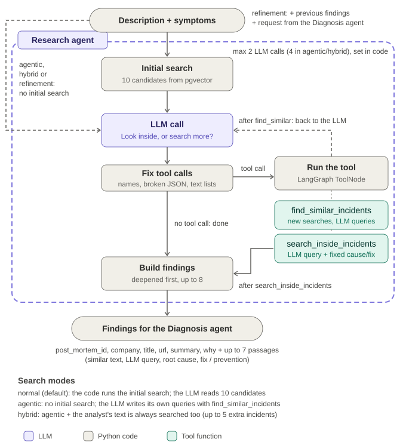

# E4 — Primeiro agente: Agente Pesquisa RAG

Este documento descreve o primeiro agente do Incident Copilot, onde está a evidência de cada entrega e
como ele foi testado. O código está nesta pasta, `agents/research/`.

**Resumo:** o Agente Pesquisa RAG recebe a descrição de um incidente em andamento e encontra, na base de
post-mortems, os incidentes passados mais parecidos com os trechos que explicam a causa e a correção de
cada um. Uma busca inicial em código traz 10 candidatos; o LLM lê o título e o resumo de cada um e
decide, chamando ferramentas, quais aprofundar e com que consulta, ou se procura outros incidentes. No teste
completo (32 perguntas), o incidente certo foi aprofundado em todas as perguntas em que estava entre os 10
candidatos, e os trechos entregues traziam a correção completa em 23 dos 27 incidentes conferidos à mão.

**Troca de modelo (18/11):** o `openai/gpt-oss-20b` saiu do NVIDIA NIM em 18/11/2026. A equipe adotou o
`nvidia/nemotron-3.5-super-vl-120b-a12b`. Com o mesmo agente, ele repetiu o resultado do GPT-OSS nas 32 perguntas
(duas rodadas), sem nenhum problema de chamada de ferramenta e em ~12 s por pergunta (o GPT-OSS levava ~3 min).
A rapidez permitiu testar a suíte inteira da E2: o incidente certo foi aprofundado em 284 de 284 perguntas em que
estava entre os 10 candidatos (ver a seção 7). Os resultados das seções 7 e 8 até 17/11 são do GPT-OSS-20B.

## 1. Entregas e evidências

| Entrega | O que foi feito | Evidência |
|---|---|---|
| **4.1** Primeiro agente | Agente Pesquisa RAG em LangGraph: papel e instruções no prompt, duas ferramentas, decisão pelo LLM, saída estruturada (`findings`) | `agents/research/agent.py`, `agents/research/prompts.py` |
| **4.2** Agente com o RAG como ferramenta | o LLM chama a busca do RAG (`rag/busca.py`) por meio das ferramentas, decidindo se busca, qual ferramenta usar, em quais incidentes e com que consulta | `agents/research/tools.py` |
| **4.3** Ferramentas | `search_inside_incidents` e `find_similar_incidents`, com schema, validação e limites | `agents/research/tools.py` |
| **4.4** Testes do agente isolado | 12 perguntas da E3 + 20 perguntas difíceis da suíte da E2; incidente certo aprofundado, chamadas de ferramenta válidas e causa/correção conferidas à mão | `agents/research/experiments/`, `agents/research/experiments/results/README.md` |
| **4.5** Documentação | este documento | |

## 2. Papel e responsabilidades

No desenho da E1.2, o Agente Pesquisa RAG fica entre o Agente Triagem e o Agente Diagnóstico.

**Faz:**
- encontra os incidentes passados mais parecidos com o incidente atual;
- escolhe quais deles aprofundar e busca, dentro de cada um, os trechos de causa e de correção;
- procura outros incidentes quando os encontrados não servem;
- registra todas as buscas feitas (rastreabilidade).

**Não faz:**
- não responde ao analista;
- não avalia se a evidência basta: isso é do Agente Diagnóstico;
- não controla o número de tentativas do loop de refinamento: isso é do roteamento do grafo principal.

## 3. Entrada e saída

**Entrada** (estado do LangGraph):

| Campo | O que é | Origem |
|---|---|---|
| `description` | descrição do incidente em andamento | analista |
| `symptoms` | sintomas separados, opcional | Agente Triagem (`TriageResult.symptoms`) |
| `search_request` | o que falta, opcional (refinamento) | Agente Diagnóstico (ainda não existe) |
| `candidates`, `seen_ids` | achados de uma rodada anterior (refinamento) | rodada anterior do agente |

**Saída:**

| Campo | O que é |
|---|---|
| `findings` | até 8 incidentes, os aprofundados primeiro. Cada um com `post_mortem_id`, `company`, `title`, `url`, `summary`, `similarity`, `deepened`, `why` (por que o LLM o escolheu) e até 7 trechos (`passages`) |
| `search_log` | registro de cada busca: etapa, consulta, filtro e IDs encontrados |
| `llm_calls` | tempo, tokens, ferramentas chamadas e correções aplicadas em cada chamada ao LLM |

Cada trecho traz `section`, `content`, `similarity` e `origin`: `similar` (busca inicial) ou `deep_search`
(aprofundamento), com a consulta que o trouxe (`query`) e de onde ela veio (`query_source`: `llm`, `cause` ou `fix`).

O código e os nomes estão em inglês, como no Agente Triagem. A busca em si continua no `rag/busca.py` (E3, em
português); as duas funções do topo de `tools.py` traduzem o resultado dela para os nomes em inglês.

## 4. O fluxo

```
1ª volta:     START → initial_search → agent ⇄ tools → build_findings → END
refinamento:  START → agent ⇄ tools → build_findings → END
```



Como ler o desenho: a linha tracejada roxa marca o que está **dentro do agente**. Roxo é o LLM, cinza é código
Python e verde são as ferramentas. As setas tracejadas são os caminhos que voltam ou pulam etapas: a busca
inicial é pulada nos modos agêntico e híbrido e no refinamento, e os incidentes novos de
`find_similar_incidents` voltam ao LLM. Depois de `search_inside_incidents`, ou quando o LLM encerra sem
chamar ferramenta, o fluxo segue para `build_findings`, que monta a saída para o Agente Diagnóstico.

| Nó | O que faz | LLM? |
|---|---|---|
| `initial_search` | busca em duas etapas da E3 com a descrição e com cada sintoma; junta por incidente e fica com os 10 mais parecidos | não |
| `agent` | LLM no NVIDIA NIM (`nvidia/nemotron-3.5-super-vl-120b-a12b`; até 17/11, `openai/gpt-oss-20b`), via `ChatNVIDIA` com `tool_choice="auto"`: lê título e resumo dos candidatos e decide se chama uma ferramenta | sim |
| `tools` | `ToolNode` do LangGraph: executa a ferramenta chamada | não |
| `build_findings` | junta candidatos, incidentes novos e trechos do aprofundamento; ordena, limita e registra | não |

**Roteamento (código):**
- do `START`: se já há candidatos (refinamento) ou o modo é agêntico/híbrido, vai direto ao `agent`; senão, à `initial_search`;
- do `agent`: se chamou ferramenta, vai às `tools`; senão, a `build_findings`;
- das `tools`: volta ao `agent` só se a ferramenta foi `find_similar_incidents` e o LLM foi chamado
  menos de 2 vezes (4 nos modos agêntico e híbrido); senão, vai a `build_findings`.

O LLM recebe só o título e o resumo de cada candidato (~3 mil caracteres para 10 candidatos). Os resumos do
catálogo do danluu costumam dizer o que aconteceu e por quê; os detalhes chegam pelo aprofundamento.

## 5. Ferramentas

### `search_inside_incidents`

Busca, dentro de incidentes já encontrados, os trechos que explicam a causa e a correção.

| Argumento | O que é |
|---|---|
| `searches` | lista de até 3 itens `{post_mortem_id, query, why}`: o incidente, uma consulta curta em inglês e uma frase dizendo por que foi escolhido |

Para cada incidente, o código traz:
- até 2 trechos pela consulta do LLM;
- 1 trecho pela consulta fixa de causa (*"what was the root cause of the failure"*);
- 2 trechos pela consulta fixa de correção (*"how the problem was corrected, remediation, action items,
  prevention, next steps"*), dando preferência a trechos cujo título de seção indica correção
  (*How was the problem corrected*, *Remediation*, *Action Items*, *Next steps*…).

Trechos repetidos ou com menos de 200 caracteres ficam de fora. Só são aceitos IDs que o agente já viu.

### `find_similar_incidents`

Procura outros incidentes parecidos com o atual.

| Argumento | O que é |
|---|---|
| `queries` | até 2 consultas curtas em inglês |

Usa a mesma busca em duas etapas, excluindo os incidentes já vistos, e devolve até 5 incidentes com título
e resumo. Depois disso, o LLM é chamado de novo e pode aprofundar os novos.

As duas ferramentas devolvem um texto curto para o LLM e os dados completos para o `build_findings`
(`response_format="content_and_artifact"`).

## 6. Critérios de decisão

**O que o LLM decide** (instruções em `prompts.py`):
1. comparar o incidente atual com o resumo de cada candidato, até o último: mesmo tipo de falha, mesmo
   componente, mesmo gatilho; palavras em comum não bastam;
2. aprofundar os que mais se parecem (até 3), com uma consulta e o `why` de cada um;
3. se nenhum tem relação com o atual, procurar outros com `find_similar_incidents`;
4. se houver pedido do Diagnóstico, segui-lo;
5. quando tiver buscado o necessário, encerrar sem chamar ferramentas.

**O que fica em código:**
- limites: até 3 incidentes aprofundados, até 2 consultas novas, até 2 chamadas ao LLM, até 8 incidentes e
  7 trechos por incidente na saída;
- validação: só IDs já vistos; consulta vazia é ignorada;
- correções do formato do modelo: nome de ferramenta com o canal do formato harmony vazado
  (`search_inside_incidents<|channel|>commentary`) é corrigido pelo prefixo; JSON de argumentos sem fechar é
  completado; campo `why` esquecido é preenchido vazio; se a chamada não puder ser consertada, o modelo
  recebe o erro e tenta de novo uma vez;
- novas tentativas em erro do NIM (tempo esgotado, 429, 5xx): até 3, com espera crescente.

## 7. Testes do agente isolado

Script: `agents/research/experiments/evaluate_research.py` (opções `--file`, `--questions`, `--parallel`,
`--no-llm`, `--hybrid`, `--agentic`). Cada rodada gera um `.md` e um `.json` em `agents/research/experiments/results/`.
As rodadas até 23/11 (arquivos `pesquisa_*`) são da versão com o código em português.

**Perguntas:**
- **12 da E3** (`rag/avaliacao/perguntas.json`): o incidente certo quase sempre vem em 1º na busca; uma
  pergunta é sobre um incidente fora do corpus (q12, o Pix);
- **20 difíceis** (`agents/research/experiments/questions_hard.json`): perguntas de sintoma da suíte da E2
  em que a busca põe o certo abaixo do 3º lugar (8 em 4º–5º, 6 em 6º–10º, 6 além do 10º).

**O que foi conferido:**
- **decisão:** o LLM aprofundou o incidente certo?
- **ferramentas:** as chamadas vieram válidas? precisaram de correção?
- **saída:** os trechos entregues trazem a causa e a correção? Leitura dos trechos inteiros do incidente
  certo, comparando com o post-mortem completo para separar falha da busca de limite do corpus
  (`results/conferencia_causa_correcao_2026-11-17.md`).

**Resultado da versão atual** (rodadas `2026-11-17_1831` e `2026-11-17_1840_perguntas_dificeis`):

| | Resultado |
|---|---|
| certo aprofundado, 12 da E3 | 11/11 |
| certo aprofundado, difíceis 4º–5º | 8/8 |
| certo aprofundado, difíceis 6º–10º | 6/6 |
| certo aprofundado, difíceis além do 10º | 0/6 |
| causa completa nos trechos (27 incidentes) | 24 (3 parciais) |
| correção completa nos trechos (27 incidentes) | 23 (3 parciais, 1 ausente) |
| chamadas ao LLM | 33, todas executadas; 2 com JSON sem fechar, consertadas em código |
| q12 (fora do corpus) | procurou outros incidentes e encerrou sem aprofundar nenhum |

As correções parciais ou ausentes são limite do corpus: uma issue do GitHub (Steam), uma thread de e-mail
(kernel) e um post curto (BBC) que não descrevem a correção.

**Como se chegou à versão atual** (detalhe em `results/README.md`):

| Mudança | Efeito medido |
|---|---|
| LLM escolhendo o que aprofundar, em vez de aprofundar sempre os 3 primeiros | certo em 4º–5º: 8/8 contra 0/8 |
| o LLM chama as ferramentas, em vez de devolver um plano que o código executa | atende a 4.2; nas difíceis, 2 acertos com `find_similar_incidents` |
| 10 candidatos com título e resumo, em vez de 5 com trechos | certo em 6º–10º: de 2/6 para 6/6, com 1 chamada ao LLM |
| consultas fixas separadas em causa e correção, com preferência por título de correção | correção completa: de 11 para 17 dos 20 incidentes conferidos |
| testado e retirado: o LLM avaliar cada incidente como strong/partial/weak | o modelo marcou incidentes errados como strong nas 6 perguntas difíceis |
| testado e retirado: uma consulta alternativa sempre executada em código | 1 acerto em 6, com 2 incidentes de ruído em toda pergunta |

**Com o Nemotron 3.5 super-vl** (rodadas de 18/11, `results/README.md`):

| | Resultado |
|---|---|
| 12 da E3 + 20 difíceis, 2 rodadas | igual ao GPT-OSS nas duas: 11/11, 8/8, 6/6, 0/6 |
| 137 perguntas de sintoma da suíte da E2, 2 rodadas | certo aprofundado em 130/131 e 131/131 até o 10º lugar; 0/6 além do 10º |
| suíte inteira da E2 (295 perguntas: sintoma, causa e geral) | certo aprofundado em 284/284 até o 10º lugar; das 5 fora do corpus, 3 procuraram outros incidentes e encerraram sem aprofundar |
| chamadas de ferramenta | sem JSON malformado nem nome vazado; 1 vez a lista de argumentos veio como texto (convertida em código) |
| tempo | ~10 a 12 s por pergunta (mediana) |

Com 20 candidatos em vez de 10 (`--candidates 20`), as 4 perguntas de sintoma com o certo entre o 11º e o 20º
também foram resolvidas, sem perder nenhuma das outras. O padrão ficou em 10, porque poucos casos se beneficiam.

## 8. Limitações

- **Incidente certo além do 10º lugar:** o agente não o encontra, porque quase nunca decide procurar outros
  quando algum candidato parece parecido. Na suíte da E2, isso acontece em ~4% das perguntas de sintoma.
- **Latência:** com o GPT-OSS-20B, cada chamada ao NIM gratuito levava ~2,5 minutos; com o Nemotron 3.5 super-vl, ~10 s.
- **Dependência do provedor:** o modelo usado até 17/11 saiu do NIM sem aviso prévio no projeto; o mesmo pode acontecer com o atual.
- **Caminhos testados só em parte:** a entrada com sintomas e o refinamento com pedido do Diagnóstico ainda
  não foram testados na versão atual; dependem dos agentes Triagem e Diagnóstico.
- **Amostra pequena e modelo variável:** cada versão rodou uma vez, com `temperature=1.0`. Diferenças de 1 ou
  2 perguntas são tendência, não prova.
- **Ruído nos trechos de correção:** em alguns incidentes, o título da seção indica correção, mas o conteúdo
  não ajuda (lista de arquivos, pedido de desculpas).

## 9. Como rodar

A partir da raiz do repositório, com o banco no ar (`docker compose up -d`) e o `.env` configurado:

```bash
# uma investigação
multiagent_env/bin/python -I agents/research/agent.py "descrição do incidente" [--symptom "..."] [--json saida.json]

# refinamento a partir de uma rodada anterior
multiagent_env/bin/python -I agents/research/agent.py "descrição" --previous saida.json --request "o que falta"

# testes
multiagent_env/bin/python -I agents/research/experiments/evaluate_research.py --parallel 2
multiagent_env/bin/python -I agents/research/experiments/evaluate_research.py --file agents/research/experiments/questions_hard.json --parallel 2
```

### Os três modos de busca

O agente tem três modos. O **atual** é o padrão; os outros dois são ligados com uma opção, em `agent.py`,
no `evaluate_research.py` e no `demo.py`:

| Modo | Opção | Quem faz a 1ª busca | 12 da E3 + 20 difíceis (certo aprofundado) |
|---|---|---|---|
| atual | (nenhuma) | o código, com a descrição do analista (10 candidatos) | 25/31; 0/6 além do 10º |
| agêntico puro | `--agentic` | o LLM, com as consultas que ele escreve | 21/31 e 24/31 em duas rodadas (varia) |
| híbrido | `--hybrid` | o LLM escreve as consultas, e o código soma a descrição original (até 5 extras) | 29/31; 4/6 além do 10º |

O híbrido acertou mais, mas faz 2 chamadas ao LLM por pergunta. Detalhes em `experiments/results/README.md`.

```bash
# demonstração passo a passo do modo híbrido (em inglês, usada na apresentação da E4)
multiagent_env/bin/python -I agents/research/demo.py [--example mars] [--pause 3]
```
