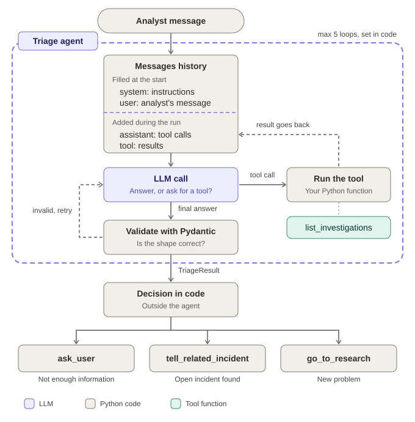

# E4 — Agente Triagem

Este documento descreve o primeiro agente funcional do projeto: o **Agente Triagem**. Ele recebe a mensagem
de um analista, decide se há informação suficiente, confere se o problema já está sendo investigado e
devolve uma resposta estruturada. Quem decide o próximo passo é o código, não o modelo.

**Resumo:** o agente usa o `nvidia/nemotron-3.5-super-vl-120b-a12b` (NVIDIA NIM) e uma única ferramenta, `list_investigations`.
O modelo extrai os sintomas, decide se a informação basta e, se basta, consulta as investigações abertas
antes de responder. A resposta é validada com Pydantic e com duas regras em código. Nos testes, 33 checks
sem modelo e 6 cenários reais com o modelo (18 checks) passaram.

## 1. Papel e responsabilidades

O Triagem é a porta de entrada do fluxo. Ele **não diagnostica** e **não busca nos postmortems**; isso é
trabalho dos agentes seguintes.

| Responsabilidade | Como |
|---|---|
| Extrair os sintomas e o serviço afetado | o LLM lê a mensagem e preenche `symptoms` e `affected_service` |
| Decidir se a informação basta | o LLM preenche `enough_information`; precisa de um sintoma **e** de onde ocorre |
| Pedir o que falta | `missing_information`, com perguntas no idioma do analista; quando já precisa perguntar o sintoma ou o serviço, pergunta junto, uma única vez, se algo mudou logo antes do problema (E5, política B; a política A, perguntar sempre, fica em `prompts.py` com `set_trigger_policy("A")`) |
| Registrar as mudanças citadas | `triggers` (E5): cada mudança que o analista citou (deploy, comando, configuração...), todas, não só a mais recente |
| Evitar investigação duplicada | consulta `list_investigations` e preenche `related_incident` se achar a mesma |
| Dar uma pista de categoria | `category` (opcional), só quando a mensagem deixa claro; ajuda a pesquisa depois |

## 2. Entradas e saídas

**Entrada:** uma mensagem de texto do analista, em qualquer idioma.

**Saída:** um objeto `TriageResult` (`schema.py`):

| Campo | Tipo | Significado |
|---|---|---|
| `symptoms` | lista de texto | sintomas, em inglês |
| `affected_service` | texto ou `null` | serviço afetado, curto e em minúsculas |
| `triggers` | lista de texto | (E5) o que mudou logo antes do problema, como o analista disse, em inglês; vazia se ele não citou nenhuma mudança |
| `category` | uma de 5, ou `null` | Config Errors, Hardware/Power Failures, Conflicts, Database, Time. Quase sempre `null` |
| `enough_information` | verdadeiro/falso | se dá para seguir sem perguntar |
| `missing_information` | lista de texto | perguntas ao analista (vazia quando `enough_information` é verdadeiro) |
| `related_incident` | `{incident_id, title}` ou `null` | investigação aberta que é o mesmo problema |

Regra de consistência no próprio esquema: se `enough_information` é falso, `missing_information` não pode
estar vazia e `related_incident` tem de ser `null`.

Exemplo de saída para um duplicado:

```json
{
  "symptoms": ["login page returning error 500"],
  "affected_service": "login",
  "category": null,
  "enough_information": true,
  "missing_information": [],
  "related_incident": {"incident_id": "INC-042", "title": "Login page returns HTTP 500 after the 14:00 deploy; Redis connection timeouts in the logs"}
}
```

## 3. Ferramenta

Uma só ferramenta, chamada pelo modelo quando ele decide (`tool_choice="auto"`).

| Ferramenta | Parâmetro | Retorno |
|---|---|---|
| `list_investigations` | `service` (opcional, texto) | lista com `incident_id`, `summary`, `service`, `status`, `opened_at` |

O filtro por serviço é uma comparação simples, sem distinguir maiúsculas. Se nada bate, a ferramenta devolve
**todas** as investigações com uma nota, para o modelo não concluir "não existe" por causa de um nome
escrito diferente. Hoje os dados vêm de `data/investigations.json` (4 investigações de teste); quando
existir persistência real, só muda essa função.

Não são ferramentas: montar o prompt (é contexto) e validar a resposta (é uma proteção).

## 4. Fluxo interno

```
Mensagem do analista
        │
        ▼
Messages history  ← começa com: system (instruções) + user (mensagem)
        │             vai recebendo: assistant (pedido de ferramenta) + tool (resultado)
        ▼
   Chamada ao LLM ──── pede a ferramenta ──► roda list_investigations ──► resultado volta à history
        │                                                                          │
        │◄─────────────────────────────────────────────────────────────────────────┘
        ▼ resposta final
Validação (Pydantic + 2 regras) ── inválida: devolve o erro ao modelo e tenta de novo
        │
        ▼ TriageResult
Decisão em código (fora do agente)
```

A **Messages history** é a memória de uma execução: a lista de mensagens enviada ao modelo a cada chamada.


Como ler o desenho: a linha tracejada roxa marca o que está **dentro do agente**; a linha tracejada dentro da
Messages history separa o que é preenchido **no início** do que é adicionado **durante a execução**. Roxo é o
LLM, cinza é código Python e verde é a função da ferramenta. A decisão final e as três saídas ficam fora do agente.

O laço roda no máximo **5 vezes** (`MAX_TURNS`); se não houver resposta válida, levanta erro.

## 5. Critérios de decisão

### 5.1 O que o modelo decide (guiado pelo prompt)

1. **Informação suficiente?** Precisa de um sintoma e de onde ocorre. Se não, **não** chama a ferramenta e
   devolve perguntas.
2. **Se suficiente**, **deve** chamar `list_investigations`, passando o serviço.
3. **Mesmo problema?** Só se o serviço **e** os sintomas coincidem. Outro sintoma no mesmo serviço é outro
   problema. Investigações fechadas nunca contam.

### 5.2 O que o código garante (`agent.py`)

| Regra | Por quê |
|---|---|
| `related_incident` deve ser uma investigação **aberta** devolvida pela ferramenta | o modelo não pode inventar um id nem apontar para uma investigação fechada |
| Se `enough_information` é verdadeiro, a ferramenta tem de ter sido usada | num teste o modelo respondeu direto, sem consultar, o que deixaria passar um duplicado |

Quando uma regra falha, o erro volta ao modelo como mensagem e ele corrige (dentro das 5 voltas).

### 5.3 A decisão final (`routing.py`)

Fora do agente, o código escolhe o próximo passo, nesta ordem:

| Condição | Próximo passo | O que acontece |
|---|---|---|
| `enough_information` é falso | `ask_user` | devolve as perguntas ao analista |
| há `related_incident` | `tell_related_incident` | avisa que o problema já foi reportado, com o `incident_id` |
| nenhuma das duas | `go_to_research` | segue para o agente pesquisador |

## 6. Decisões de projeto

| Decisão | Motivo |
|---|---|
| Uma ferramenta só | basta para o caso de uso; o agente fica pequeno e fácil de entender |
| Laço escrito à mão, sem framework | mais fácil de estudar; depois vira um nó do LangGraph na E5 |
| Decisão final em código | é previsível e testável; o modelo só extrai e compara |
| Validar a resposta e reenviar o erro | o modelo às vezes inventa argumentos ou escolhe a ferramenta errada; assim ele se corrige |
| `category` opcional | 115 dos 212 documentos do danluu são "Uncategorized"; forçar uma categoria seria chute |
| Segundo caminho (`get_investigation`) fora | complementar uma investigação existente fica para depois |

## 7. Como rodar

Todos os comandos, a partir da raiz do repositório. Cada cenário leva de 4 a 6 segundos. É preciso `NVIDIA_API_KEY` no `.env` da raiz.

| O que | Comando |
|---|---|
| Testes sem modelo (instantâneos) | `.venv/Scripts/python.exe -m agents.triage.tests.test_schema` (também `test_tools`, `test_routing`, `test_agent_rules`) |
| Ver uma execução por dentro, com uma mensagem sua | `.venv/Scripts/python.exe -m agents.triage.tests.test_agent_loop "sua mensagem"` |
| Cenários reais, um por nome | `.venv/Scripts/python.exe -m agents.triage.tests.test_scenarios vague` |
| Todos os cenários | `.venv/Scripts/python.exe -m agents.triage.tests.test_scenarios` |

Cenários: `duplicate`, `duplicate_in_portuguese`, `new_problem`, `same_service_different_problem`,
`closed_investigation_is_ignored`, `vague`.

### Comandos da demonstração (3 casos)

Cada comando mostra a Messages history completa, o resultado em JSON e o próximo passo. Rodar um de cada vez.

Caso 1, mensagem vaga. Esperado: `ask_user`, sem usar a ferramenta.

```bash
.venv/Scripts/python.exe -m agents.triage.tests.test_agent_loop "Something is broken, please help!"
```

Caso 2, problema já reportado. Esperado: `tell_related_incident`, com o `incident_id` INC-042.

```bash
.venv/Scripts/python.exe -m agents.triage.tests.test_agent_loop "Since the deploy this afternoon the login page is returning error 500."
```

Caso 3, problema novo. Esperado: `go_to_research`, com os sintomas extraídos.

```bash
.venv/Scripts/python.exe -m agents.triage.tests.test_agent_loop "Our recommendations API is returning empty lists messages since this morning for all types of Products"
```

## 8. Evidências dos testes

**Sem modelo: 33 checks, todos passam** (esquema 9, ferramenta 13, decisão 3, regras do agente 8).

**Com o modelo: 6 cenários, 18 de 18 checks** (refeitos com o `nemotron-3.5-super-vl` depois da troca de modelo).

| Cenário | Esperado | Resultado |
|---|---|---|
| `duplicate` — página de login com erro 500 após o deploy | `tell_related_incident`, INC-042 | passou |
| `duplicate_in_portuguese` — mesma situação em português | `tell_related_incident`, INC-042 | passou |
| `new_problem` — recommendations devolve listas vazias | `go_to_research` | passou |
| `same_service_different_problem` — login lento, sem erro | `go_to_research` (outro sintoma) | passou |
| `closed_investigation_is_ignored` — batch-jobs sem memória | `go_to_research` (INC-043 está fechada) | passou |
| `vague` — "Something is broken, please help!" | `ask_user`, sem usar a ferramenta | passou |

Depois de renomear `id` para `incident_id`, o cenário `duplicate` foi rodado de novo e passou (3 de 3).

## 9. Limitações conhecidas

- **Troca de modelo:** o `openai/gpt-oss-20b`, usado no início, foi desativado pelo NVIDIA em 18/11/2026
  (erro HTTP 410). O Triagem passou para o `nvidia/nemotron-3.5-super-vl-120b-a12b`, que também chama ferramentas e
  é bem mais rápido (o `mistral-large-4` também passou nos 6 cenários, em 16 a 72 s). O modelo pode ser trocado com `LLM_MODEL` no `.env`. O RAG (`rag/llm.py`) e o agente
  pesquisador ainda apontam para o modelo antigo e precisam da mesma troca.
- **Dados de teste:** as 4 investigações em `data/investigations.json` são fictícias.
- **`category` é um palpite:** numa execução do `duplicate` o modelo preencheu `Config Errors` sem pista
  clara. É opcional e só serve de dica para a pesquisa.
- **Não confirma com o analista** se o problema é mesmo o mesmo; isso fica para a interface.
- **Não complementa** investigações existentes (`get_investigation` não foi feito).

## 10. Arquivos

| Arquivo | Conteúdo |
|---|---|
| `schema.py` | esquema Pydantic da resposta (`TriageResult`, `RelatedIncident`) |
| `tools.py` | a ferramenta `list_investigations` e sua descrição para o modelo |
| `prompts.py` | instruções do agente |
| `agent.py` | o laço, as 2 regras de proteção e `run_agent` |
| `routing.py` | a decisão final: `ask_user`, `tell_related_incident`, `go_to_research` |
| `llm.py` | cliente do NVIDIA NIM com novas tentativas em erro temporário |
| `data/investigations.json` | investigações de teste |
| `node.py` | o agente como nó do LangGraph (duas funções que embrulham o agente, sem reescrevê-lo) |
| `tests/` | testes sem modelo e cenários reais |

## 11. Como nó do LangGraph

O agente mantém o próprio laço (`agent.py`). O arquivo `node.py` só o embrulha para o grafo principal:

| Função | O que faz |
|---|---|
| `triage_node(state)` | lê `description` do estado, roda o agente e escreve `triage_result` (o `TriageResult` completo) e `symptoms` (a entrada do Agente Pesquisa) |
| `route_after_triage(state)` | aresta condicional: devolve `ask_user`, `tell_related_incident` ou `go_to_research`, a mesma decisão do `routing.py` |

A Messages history fica dentro do agente e não entra no estado compartilhado, porque o Agente Pesquisa tem a
sua própria chave `messages` e as duas se misturariam.

Teste: `.venv/Scripts/python.exe -m agents.triage.tests.test_node` (grafo LangGraph de verdade com o agente
trocado por um falso: 7 checks, sem modelo). Também foi rodado com o modelo real, passando pelo nó: os três
casos da demonstração foram para `ask_user`, `tell_related_incident` e `go_to_research`.
