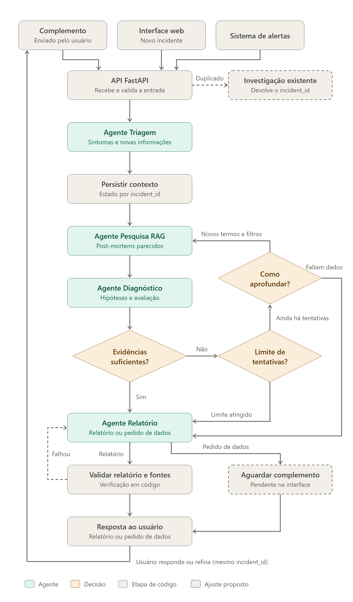
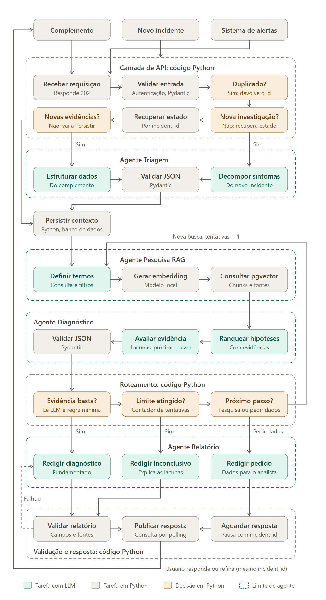

# E1.2 — Proposta de Arquitetura de Agentes

**Projeto 4 — Incident Copilot / Resolução de Incidentes e Post-Mortems**  
**Situação:** proposta de design; implementação e testes ainda não realizados

## 1. Visão geral

O sistema é um workflow condicional multi-agente: o código define os caminhos possíveis do fluxo, os agentes fazem a interpretação com o LLM e o código decide, a cada passo, qual caminho seguir com base no que os agentes encontraram. A investigação de cada incidente é identificada por um `incident_id`, o que permite retomá-la quando o analista envia novas informações ou refina a busca.

O desenho prioriza **orquestração definida (defined orchestration)**: os caminhos de execução são estabelecidos pela aplicação; o uso de LLM ajuda na interpretação e na seleção entre caminhos permitidos, sem controlar livremente toda a execução.

## 2. Diagrama de referência

Arquitetura do Incident Copilot

Diagrama detalhado, com as tarefas internas de cada agente e as etapas em código Python:

## 3. Quantos agentes o sistema terá

O sistema terá **4 agentes**:

- **Agente Triagem:** transforma a descrição de um novo incidente, ou o complemento enviado pelo usuário, em dados estruturados (sintomas e novas informações).
- **Agente Pesquisa RAG:** encontra, na base de post-mortems e runbooks, os incidentes passados mais parecidos com o incidente atual.
- **Agente Diagnóstico:** analisa o que o Agente Pesquisa RAG encontrou, ranqueia as causas mais prováveis e avalia se a evidência é suficiente.
- **Agente Relatório:** redige a resposta para o analista: o diagnóstico, um relatório inconclusivo ou um pedido de dados.

Na primeira versão da proposta eram 2 agentes, e o Agente 2 acumulava análise, avaliação e relatório. Separamos essas tarefas para que cada agente tenha uma responsabilidade só, o que facilita testar e ajustar cada parte.

Os quatro são agentes porque usam o LLM para tomar decisões sobre o próprio trabalho: o Agente Triagem decide como interpretar a descrição, o Agente Pesquisa RAG decide como buscar, o Agente Diagnóstico decide o que as evidências indicam e se elas bastam, e o Agente Relatório decide como apresentar o resultado. As regras do fluxo (limite de tentativas, roteamento e validação do relatório) ficam em código Python. O detalhe de cada agente está na seção 4.

## 4. Responsabilidade de cada agente

**Quatro agentes especializados**, todos no workflow condicional:

| Agente | Responsabilidade | Recebe | Entrega |
|---|---|---|---|
| **Agente Triagem** | Decompor os sintomas de um novo incidente ou estruturar os dados de um complemento | Descrição do incidente ou complemento do usuário | Sintomas e novas informações em JSON validado com Pydantic |
| **Agente Pesquisa RAG** | Definir os termos e filtros da busca, gerar o embedding da consulta e consultar o pgvector | Sintomas, termos e filtros da investigação | Chunks, post-mortems, runbooks e fontes encontrados |
| **Agente Diagnóstico** | Ranquear as hipóteses de causa com base nas evidências, avaliar se a evidência é suficiente e indicar as lacunas e o próximo passo | Contexto do incidente atual e evidências do Agente Pesquisa RAG | Hipóteses ranqueadas e avaliação estruturada em JSON validado com Pydantic |
| **Agente Relatório** | Redigir a resposta final de acordo com o caminho escolhido pelo roteamento | Hipóteses, avaliação e decisão do roteamento | Diagnóstico fundamentado, relatório inconclusivo ou pedido de dados para o analista |

O relatório traz, para cada causa provável: causa raiz histórica, passos de remediação, código ou configuração alterados, checklist de prevenção, link para o post-mortem original e nível de confiança.

As etapas que não usam LLM ficam em código Python: a camada de API, a persistência do contexto, o roteamento entre os agentes e a validação do relatório.

## 5. Como os agentes se comunicam

A troca de informações acontece pelo **estado compartilhado da investigação** e pelas **transições do workflow**, e não por uma conversa livre entre os agentes.

1. A API recebe uma nova descrição ou um complemento associado a um `incident_id`, responde que a requisição foi recebida e valida a entrada (autenticação e estrutura com Pydantic). Se o incidente é duplicado, devolve o `incident_id` da investigação existente. Se é a continuação de uma investigação, recupera o estado pelo `incident_id`.
2. O Agente Triagem decompõe os sintomas do novo incidente ou estrutura os dados do complemento, e a saída é validada com Pydantic. Se o complemento não traz novas evidências, o fluxo vai direto para a persistência.
3. O contexto é persistido, e o workflow encaminha ao Agente Pesquisa RAG os sintomas, termos, filtros e histórico relevante da investigação.
4. O Agente Pesquisa RAG devolve as referências recuperadas: IDs dos documentos e trechos, o conteúdo dos trechos, links das fontes, metadados e o score de relevância.
5. O Agente Diagnóstico recebe o contexto do incidente atual e as evidências históricas, elabora hipóteses ranqueadas, avalia a suficiência das evidências e indica as lacunas e o próximo passo. A saída é validada com Pydantic.
6. O roteamento, em código, lê essa avaliação e adota um dos seguintes encaminhamentos:
    - **Evidências suficientes:** o Agente Relatório redige o diagnóstico fundamentado.
    - **Evidências insuficientes e limite de tentativas atingido:** o Agente Relatório redige um relatório inconclusivo, explicando as lacunas.
    - **Evidências insuficientes, com possibilidade de aprofundamento da busca:** novos termos e filtros são encaminhados ao Agente Pesquisa RAG para uma nova pesquisa (loop de refinamento), e o contador de tentativas aumenta.
    - **Ausência de dados do incidente atual:** o Agente Relatório redige um pedido de dados para o analista.
7. O diagnóstico e o relatório inconclusivo passam por uma validação em código dos campos e das fontes. Se a validação falha, o relatório volta ao Agente Relatório. O pedido de dados fica pendente na interface, aguardando a resposta do usuário.
8. O sistema publica ao usuário o relatório ou o pedido de informações. Se o usuário responder ou quiser refinar a busca, a nova mensagem entra como continuação da mesma investigação (mesmo `incident_id`) e o processo volta ao passo 1.

## 6. Fluxo de orquestração

### 6.1 Entrada e preparação (sequencial)

**Alerta / interface → API FastAPI → Validação com Pydantic → identificação de investigação duplicada, nova ou existente → Agente Triagem (sintomas ou complemento) → persistência do estado (criação ou atualização do incident_id)**

### 6.2 Investigação multiagente (sequencial e condicional)

O caminho principal é **Agente Pesquisa RAG → Agente Diagnóstico → decisão de suficiência → Agente Relatório**.

- Se há evidências suficientes, o Agente Relatório prepara um diagnóstico **fundamentado e com ressalvas**.
- Se não há evidências suficientes e o limite foi alcançado, o Agente Relatório prepara um relatório **inconclusivo**, explicitando lacunas.
- Se falta aprofundamento e ainda existe orçamento de investigação, o roteamento escolhe, com base no próximo passo indicado pelo Agente Diagnóstico, entre **refinar a busca histórica** ou **solicitar evidências atuais ao usuário**.

### 6.3 Loops controlados

- **Refinamento da busca:** o ciclo **Agente Pesquisa RAG → Agente Diagnóstico → roteamento → Agente Pesquisa RAG** só ocorre quando a busca histórica pode agregar informação e ainda há limite disponível. Cada nova busca soma 1 ao contador de tentativas. O limite de tentativas é um parâmetro **a definir na implementação**.
- **Correção do relatório:** se a validação de campos e fontes falha, o relatório volta ao Agente Relatório.
- **Continuação pelo usuário:** depois de um pedido de dados ou de um relatório, o usuário pode responder ou refinar a busca com o mesmo `incident_id`, e a investigação recomeça pela entrada.

### 6.4 Paralelismo

**Não há execução paralela de agentes prevista no MVP.** Cada agente depende da saída do anterior: a triagem precede a pesquisa, a pesquisa precede o diagnóstico, e o diagnóstico precede o relatório. Recuperações paralelas de fontes distintas poderiam ser avaliadas futuramente, caso existam novas fontes curadas; isso **não está incluído nesta proposta inicial**.

---

**Conclusão:** a arquitetura proposta possui **quatro agentes com responsabilidades complementares** (Triagem, Pesquisa RAG, Diagnóstico e Relatório), integrados por um **workflow definido, predominantemente sequencial, com decisões condicionais em código, refinamento limitado e pausa/retomada por incidente**. O desenho prevê geração de diagnóstico com fontes ou saída inconclusiva quando necessário.
