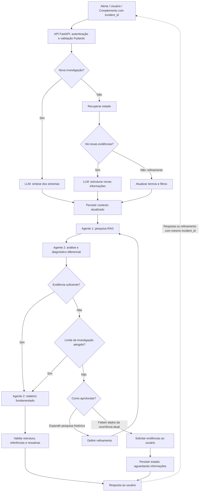

# E1.2 — Proposta de Arquitetura de Agentes

**Projeto 4 — Incident Copilot / Resolução de Incidentes e Post-Mortems**  
**Entrega:** 1.2 — Proposta de arquitetura de agentes  
**Data:** 28/10/2026  
**Situação:** proposta de design; implementação e testes ainda não realizados

## 1. Objetivo e escopo

Definir a quantidade de agentes, suas responsabilidades, a comunicação entre componentes e a orquestração da investigação. A solução recebe um incidente novo ou um complemento identificado pelo mesmo `incident_id`, organiza as evidências informadas, pesquisa **post-mortems históricos** e produz um diagnóstico preliminar fundamentado, ou solicita mais informações quando não há dados suficientes.

O desenho prioriza **orquestração definida (defined orchestration)**: os caminhos de execução são estabelecidos pela aplicação; o uso de LLM ajuda na interpretação e na seleção entre caminhos permitidos, sem controlar livremente toda a execução.

**Limite do MVP:** a E1.3 qualificou um corpus de **20 post-mortems aprovados**, que é a fonte documental do RAG inicial. O diagrama menciona *runbooks e outras fontes* como possibilidade de expansão; **não há runbooks curados no corpus inicial**. Também **não está prevista integração direta para consultar logs ou métricas de produção**: evidências da ocorrência atual são enviadas pelo usuário, interface ou sistema de alertas.

## 2. Diagrama de referência

As imagens de referência fornecidas para esta entrega mostram a mesma arquitetura em temas claro e escuro. Para mantê-las junto ao documento, colocar os arquivos na pasta `docs/` do projeto:

- `docs/E1_2_Arquitetura_Claro.png` — versão clara (`desenho.png`, conforme organização adotada ao copiar).
- `docs/E1_2_Arquitetura_Escuro.png` — versão escura (`desenho2.png`, conforme organização adotada ao copiar).

> **Nota de integração:** os nomes acima são nomes **propostos para publicação no WSL**; as duas imagens acompanham o pacote desta entrega. A especificação textual abaixo é a referência para interpretar decisões e ressalvas do desenho.

### Visão lógica resumida

O ramo de **limite atingido** gera um relatório explicitamente **inconclusivo ou de baixa confiança**, nunca uma causa raiz afirmada sem evidência. A decisão de aprofundamento pode solicitar novas evidências ou executar outra busca, mas somente dentro de limites definidos.

## 3. Quantos agentes existem?

**Dois agentes especializados**, ambos no workflow condicional:

| Componente | Classificação | Responsabilidade |
|---|---|---|
| **Agente 1 — Pesquisa RAG** | Agente | Formular/ajustar a consulta de recuperação, buscar trechos nos post-mortems aprovados, organizar achados e devolver evidências históricas com fontes e limitações. |
| **Agente 2 — Análise e diagnóstico diferencial** | Agente | Confrontar os sintomas atuais com os trechos recuperados, elaborar hipóteses ordenadas, diferenciar fatos e conjecturas, avaliar a suficiência e redigir o relatório final ou inconclusivo. |
| LLM de síntese/estruturação | Chamada de modelo, **não um agente** | Transformar descrição livre ou evidências adicionais em representação estruturada; não escolhe ferramentas nem conduz um ciclo independente de investigação. |
| Supervisor/roteamento condicional | Lógica do workflow, **não um terceiro agente** | Selecionar entre transições permitidas a partir de estado, respostas estruturadas e regras de negócio; impor limites de tentativas. |
| API, persistência, validação | Componentes de aplicação | Receber requisições, autenticar/validar, armazenar e recuperar estado, validar saídas e disponibilizar respostas. |

**Observação sobre o diagrama:** a caixa “Agente 2 — Gerar relatório” representa **uma segunda responsabilidade do mesmo Agente 2**, não um terceiro agente.

## 4. Comunicação entre agentes e módulos

A troca de informações é **mediada pelo estado compartilhado da investigação e pelas transições do workflow**, e não por conversação irrestrita entre agentes.

1. A API recebe uma nova descrição ou um complemento associado a `incident_id` e valida a estrutura de entrada.
2. O módulo inicial sintetiza a descrição ou organiza as novas evidências.
3. O contexto é persistido; o workflow encaminha ao Agente 1 termos, sintomas, filtros e histórico relevante.
4. O Agente 1 devolve referências recuperadas: IDs de documentos/chunks, trechos, URLs, metadados editoriais e indicação de relevância.
5. O Agente 2 recebe o contexto da ocorrência atual e as evidências históricas; propõe hipóteses e indica suficiência, lacunas e próximos passos possíveis.
6. O roteador aplica regras de fluxo: concluir, refinar pesquisa, solicitar evidências adicionais ou encerrar como inconclusivo.
7. Quando o usuário complementa o incidente, a API recupera o estado pelo `incident_id`, incorpora as informações e retoma o workflow.

**Campos conceituais do estado** (não são um contrato de API nem esquema SQL definitivo): `incident_id`, `status`, `incident_context`, `evidence_received`, `search_terms`, `filters`, `retrieved_references`, `hypotheses`, `uncertainties`, `refinement_count`, `max_refinements`, `pending_questions` e `report`.

Os agentes **não devem tratar relatos históricos como prova de causalidade do incidente atual**. A resposta deve manter rastreabilidade das fontes e distinguir observação, hipótese, inferência e limitação.

## 5. Fluxo de orquestração

### 5.1 Entrada e preparação (sequencial)

**Alerta / interface / complemento → API FastAPI → autenticação e validação com Pydantic → identificar nova investigação ou retomada → estruturar contexto → persistir estado.**

- **Nova investigação:** o LLM sintetiza e decompõe sintomas antes de iniciar a pesquisa.
- **Complemento com novas evidências:** o estado anterior é carregado e um LLM estrutura as informações adicionadas.
- **Retomada para refinar:** termos e filtros são atualizados sem inventar evidências novas.

A validação deve impedir a mistura de informações entre incidentes diferentes. Detalhes de endpoints, contratos, autenticação e tratamento de erros são responsabilidade da **E1.4 — Estrutura da API (Mari)** e não são definidos aqui.

### 5.2 Investigação multiagente (sequencial e condicional)

O caminho principal é **Agente 1 → Agente 2 → decisão de suficiência**.

- Se há evidências suficientes, o Agente 2 prepara um diagnóstico **fundamentado e com ressalvas**.
- Se não há evidências suficientes e o limite foi alcançado, o Agente 2 prepara um relatório **inconclusivo**, explicitando lacunas.
- Se falta aprofundamento e ainda existe orçamento de investigação, o roteador escolhe entre **refinar a busca histórica** ou **solicitar evidências atuais ao usuário**.

### 5.3 Loops controlados

O ciclo **Agente 1 → Agente 2 → roteador → refinamento → Agente 1** só ocorre quando a busca histórica pode agregar informação e ainda há limite disponível. O limite de tentativas é um parâmetro **a definir na implementação**, não um valor já medido.

Quando faltam dados do incidente atual, o fluxo **não deve criar dados fictícios nem insistir apenas em post-mortems**: grava pendências e retorna `aguardando informações`, preservando o `incident_id`.

### 5.4 Paralelismo

**Não há execução paralela de agentes prevista no MVP.** A pesquisa RAG precede a análise para que o Agente 2 receba referências e evidências completas. Recuperações paralelas de fontes distintas poderiam ser avaliadas futuramente, caso existam novas fontes curadas; isso **não está incluído nesta proposta inicial**.

## 6. Ferramentas, dados e limites

| Elemento | Uso previsto | Disponibilidade/limitação |
|---|---|---|
| **RAG histórico** | Recuperar trechos de post-mortems similares | Corpus de 20 documentos aprovado na E1.3; chunking, embeddings e indexação ainda não executados. |
| **PostgreSQL + pgvector** | Persistir documentos/chunks/vetores para busca semântica | Modelo lógico proposto na E1.4; não afirmar que o banco está provisionado. |
| **Persistência de investigação** | Guardar estado, histórico, iterações e pausas | Requisito arquitetural; mecanismo concreto e ciclo de vida serão definidos na implementação. |
| **Runbooks** | Conhecimento operacional adicional | **Fora do corpus inicial**; depende de curadoria e validação futuras. |
| **Logs e métricas** | Evidências do incidente atual | Recebidos na entrada; **sem integração direta** com observabilidade neste MVP. |
| **LangGraph** | Implementação candidata/selecionada para orquestração | Decisão de stack E1.4; o diagrama é independente de uma implementação já existente. |

## 7. Segurança, confiabilidade e supervisão

- **Autenticar e autorizar** acesso à investigação antes de consultar ou alterar estado por `incident_id`.
- **Validar entradas e saídas** por estruturas explícitas. Recomendações do modelo não substituem regras determinísticas de autorização, severidade ou políticas operacionais.
- **Manter limites** para refinamentos de busca, custo, tentativas e tamanho do contexto.
- **Preservar incertezas**: relatar hipóteses alternativas e evidências insuficientes; distinguir causas históricas de causas confirmadas no presente.
- **Não executar remediação automática**: o MVP apoia investigação e recomendações; ações operacionais permanecem sujeitas a avaliação humana.
- **Tratar textos recuperados como dados não confiáveis**: conteúdo de post-mortems não pode alterar regras, instruções ou permissões do workflow.
- **Registrar rastreabilidade**: IDs, fontes, estados e decisões do workflow para auditoria e testes.

## 8. Casos de funcionamento esperados

| Cenário | Caminho esperado | Resultado |
|---|---|---|
| Incidente novo com contexto suficiente | Síntese → RAG → análise → relatório | Hipóteses justificadas com referências históricas. |
| Incidente com correspondências históricas fracas | Síntese → RAG → análise → refinamento limitado → reanálise | Resposta fundamentada ou inconclusiva; sem loop infinito. |
| Falta de logs, sintomas ou impacto atuais | Pesquisa/análise → solicitar informações → persistir e aguardar | Perguntas específicas e possibilidade de retomada. |
| Usuário complementa o mesmo incidente | Recuperar estado → estruturar novas evidências → pesquisar/analisar | Continuidade da investigação com `incident_id`. |
| Limite de investigação atingido | Análise → relatório inconclusivo → validação | Explicitação do que se sabe, do que é incerto e do próximo dado necessário. |

## 9. Decisões e pendências

| Item | Decisão/status |
|---|---|
| Quantidade de agentes | **2** — Pesquisa RAG e Análise/Diagnóstico. |
| Padrão de orquestração | **Definida, sequencial e condicional**, com loop limitado de refinamento. |
| Supervisor | **Lógica de roteamento**, não agente independente. |
| Síntese de entrada | **Chamada de LLM**, não agente autônomo. |
| Execução paralela | **Não prevista** para o MVP inicial. |
| Corpus inicial | **20 post-mortems aprovados**; não incluir runbooks ainda. |
| Consulta automática a logs/métricas | **Não prevista** nesta versão. |
| Persistência/retomada | Prevista por `incident_id`; detalhes técnicos pendentes. |
| API FastAPI | Papel conceitual definido; **contratos e endpoints pendentes da Mari**. |
| Framework | **LangGraph** selecionado na E1.4, sujeito à implementação e validação. |
| Parâmetros operacionais e testes | Limites, desempenho, confiabilidade e resultados **não medidos** nesta entrega. |

## 10. Critérios de aceite da entrega 1.2

| Critério | Evidência nesta proposta | Status |
|---|---|---|
| Definir quantidade de agentes | Dois agentes especializados, com classificação dos componentes auxiliares | Atendido no design |
| Descrever a responsabilidade de cada agente | Seção 3 | Atendido no design |
| Explicar a comunicação entre agentes | Estado compartilhado e fluxo de referências/hipóteses, seção 4 | Atendido no design |
| Representar fluxo sequencial/condicional | Diagrama e seções 5.1–5.2 | Atendido no design |
| Descrever loops | Refinamento limitado e retomada, seção 5.3 | Atendido no design |
| Definir uso de paralelismo | Não previsto para o MVP, seção 5.4 | Atendido no design |
| Delimitar o corpus e o escopo | Seções 1 e 6 | Atendido no design |
| Validar comportamento em execução | Não há implementação nesta etapa | Pendente — próxima fase |

## 11. Referências internas

- **E1.3 — Mapeamento dos Dados:** `docs/E1_3_Mapeamento_dos_Dados.md`.
- **E1.4 — Definição do Stack Técnico:** documento de decisões técnicas (chunking, embeddings, pgvector e LangGraph; API pendente de Mari).
- **Corpus aprovado:** `datasets/danluu-ingestion/data/exports/corpus_20_by_stage/`.
- **Decisões editoriais:** `datasets/danluu-ingestion/data/reviews/editorial_reviews.csv`.

Todos os caminhos são relativos à raiz `~/bulk_projetos/treinamento_dell/`.

---

**Conclusão:** a arquitetura proposta possui **dois agentes com responsabilidades complementares**, integrados por um **workflow definido, predominantemente sequencial, com decisões condicionais, refinamento limitado e pausa/retomada por incidente**. O desenho prevê geração de diagnóstico com fontes ou saída inconclusiva quando necessário, sem assumir integrações, ferramentas ou dados que ainda não foram implementados ou curados.
