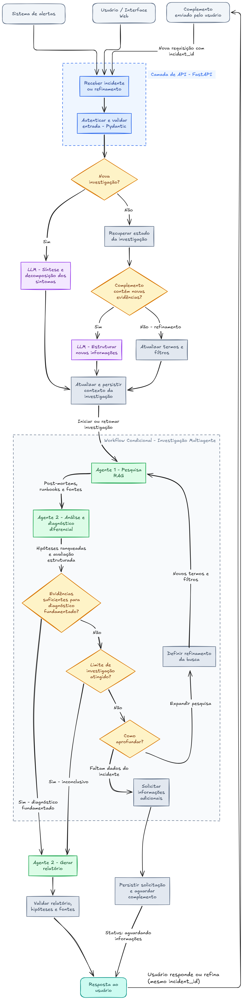

# E1.2 — Proposta de Arquitetura de Agentes

**Projeto 4 — Incident Copilot / Resolução de Incidentes e Post-Mortems**  
**Entrega:** 1.2 — Proposta de arquitetura de agentes  
**Situação:** proposta de design; implementação e testes ainda não realizados

## 1. Visão geral

O sistema é um workflow condicional multi-agente: o código define os caminhos possíveis do fluxo, e os agentes decidem, a cada passo, qual caminho seguir com base no que encontraram. A investigação de cada incidente é identificada por um `incident_id`, o que permite retomá-la quando o analista envia novas informações ou refina a busca.

O desenho prioriza **orquestração definida (defined orchestration)**: os caminhos de execução são estabelecidos pela aplicação; o uso de LLM ajuda na interpretação e na seleção entre caminhos permitidos, sem controlar livremente toda a execução.

## 2. Diagrama de referência

Arquitetura do Incident Copilot

## 3. Quantos agentes o sistema terá

O sistema terá **2 agentes**:
 
- **Agente 1 — Pesquisa RAG:** encontra, na base de post-mortems e runbooks, os incidentes passados mais parecidos com o incidente atual.
- **Agente 2 — Análise e diagnóstico diferencial:** interpreta o que o Agente 1 encontrou, indica as causas mais prováveis e diz se a evidência é suficiente. No fim da investigação, gera o relatório.

## 4. Responsabilidade de cada agente

**Dois agentes especializados**, ambos no workflow condicional:

| Componente | Classificação | Responsabilidade |
|---|---|---|
| **Agente 1 — Pesquisa RAG** | Agente | Formular/ajustar a consulta de recuperação, buscar trechos nos post-mortems aprovados, organizar achados e devolver evidências históricas com fontes e limitações. |
| **Agente 2 — Análise e diagnóstico diferencial** | Agente | Confrontar os sintomas atuais com os trechos recuperados, elaborar hipóteses ordenadas, diferenciar fatos e conjecturas, avaliar a suficiência e redigir o relatório final ou inconclusivo. |
| LLM de síntese/estruturação | Chamada de modelo, **não um agente** | Transformar descrição livre ou evidências adicionais em representação estruturada; não escolhe ferramentas nem conduz um ciclo independente de investigação. |
| Supervisor/roteamento condicional | Lógica do workflow, **não um terceiro agente** | Selecionar entre transições permitidas a partir de estado, respostas estruturadas e regras de negócio; impor limites de tentativas. |
| API, persistência, validação | Componentes de aplicação | Receber requisições, autenticar/validar, armazenar e recuperar estado, validar saídas e disponibilizar respostas. |

**Observação sobre o diagrama:** a caixa “Agente 2 — Gerar relatório” representa **uma segunda responsabilidade do mesmo Agente 2**, não um terceiro agente.

## 5. Comunicação entre agentes e módulos

A troca de informações é **mediada pelo estado compartilhado da investigação e pelas transições do workflow**, e não por conversação irrestrita entre agentes.

1. A API recebe uma nova descrição ou um complemento associado a `incident_id` e valida a estrutura de entrada.
2. O módulo inicial sintetiza a descrição ou organiza as novas evidências.
3. O contexto é persistido; o workflow encaminha ao Agente 1 termos, sintomas, filtros e histórico relevante.
4. O Agente 1 devolve referências recuperadas: IDs de documentos/chunks, trechos, URLs, metadados editoriais e indicação de relevância.
5. O Agente 2 recebe o contexto da ocorrência atual e as evidências históricas; propõe hipóteses e indica suficiência, lacunas e próximos passos possíveis.
6. O roteador aplica regras de fluxo: concluir, refinar pesquisa, solicitar evidências adicionais ou encerrar como inconclusivo.
7. Quando o usuário complementa o incidente, a API recupera o estado pelo `incident_id`, incorpora as informações e retoma o workflow.

**Campos conceituais do estado** (não são um contrato de API nem esquema SQL definitivo): `incident_id`, `status`, `incident_context`, `evidence_received`, `search_terms`, `filters`, `retrieved_references`, `hypotheses`, `uncertainties`, `refinement_count`, `max_refinements`, `pending_questions` e `report`.

Os agentes **não devem tratar relatos históricos como prova de causalidade do incidente atual**. A resposta deve manter rastreabilidade das fontes e distinguir observação, hipótese, inferência e limitação.

## 6. Fluxo de orquestração

### 5.1 Entrada e preparação (sequencial)

**Alerta / interface / complemento → API FastAPI → autenticação e validação com Pydantic → identificar nova investigação ou retomada → estruturar contexto → persistir estado.**

- **Nova investigação:** o LLM sintetiza e decompõe sintomas antes de iniciar a pesquisa.
- **Complemento com novas evidências:** o estado anterior é carregado e um LLM estrutura as informações adicionadas.
- **Retomada para refinar:** termos e filtros são atualizados sem inventar evidências novas.

A validação deve impedir a mistura de informações entre incidentes diferentes. Detalhes de endpoints, contratos, autenticação e tratamento de erros são responsabilidade da **E1.4 — Estrutura da API (Mari)** e não são definidos aqui.

### 5.2 Investigação multiagente (sequencial e condicional)

O caminho principal é **Agente 1 → Agente 2 → decisão de suficiência**.

- Se há evidências suficientes, o Agente 2 prepara um diagnóstico **fundamentado e com ressalvas**.
- Se não há evidências suficientes e o limite foi alcançado, o Agente 2 prepara um relatório **inconclusivo**, explicitando lacunas.
- Se falta aprofundamento e ainda existe orçamento de investigação, o roteador escolhe entre **refinar a busca histórica** ou **solicitar evidências atuais ao usuário**.

### 5.3 Loops controlados

O ciclo **Agente 1 → Agente 2 → roteador → refinamento → Agente 1** só ocorre quando a busca histórica pode agregar informação e ainda há limite disponível. O limite de tentativas é um parâmetro **a definir na implementação**, não um valor já medido.

Quando faltam dados do incidente atual, o fluxo **não deve criar dados fictícios nem insistir apenas em post-mortems**: grava pendências e retorna `aguardando informações`, preservando o `incident_id`.

### 5.4 Paralelismo

**Não há execução paralela de agentes prevista no MVP.** A pesquisa RAG precede a análise para que o Agente 2 receba referências e evidências completas. Recuperações paralelas de fontes distintas poderiam ser avaliadas futuramente, caso existam novas fontes curadas; isso **não está incluído nesta proposta inicial**.

## 7. Ferramentas, dados e limites

| Elemento | Uso previsto | Disponibilidade/limitação |
|---|---|---|
| **RAG histórico** | Recuperar trechos de post-mortems similares | Corpus de 20 documentos aprovado na E1.3; chunking, embeddings e indexação ainda não executados. |
| **PostgreSQL + pgvector** | Persistir documentos/chunks/vetores para busca semântica | Modelo lógico proposto na E1.4; não afirmar que o banco está provisionado. |
| **Persistência de investigação** | Guardar estado, histórico, iterações e pausas | Requisito arquitetural; mecanismo concreto e ciclo de vida serão definidos na implementação. |
| **Runbooks** | Conhecimento operacional adicional | **Fora do corpus inicial**; depende de curadoria e validação futuras. |
| **Logs e métricas** | Evidências do incidente atual | Recebidos na entrada; **sem integração direta** com observabilidade neste MVP. |
| **LangGraph** | Implementação candidata/selecionada para orquestração | Decisão de stack E1.4; o diagrama é independente de uma implementação já existente. |

---

**Conclusão:** a arquitetura proposta possui **dois agentes com responsabilidades complementares**, integrados por um **workflow definido, predominantemente sequencial, com decisões condicionais, refinamento limitado e pausa/retomada por incidente**. O desenho prevê geração de diagnóstico com fontes ou saída inconclusiva quando necessário, sem assumir integrações, ferramentas ou dados que ainda não foram implementados ou curados.
