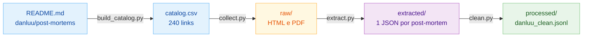

# E2.2 — Pipeline de Ingestão (danluu)

Scripts que transformam a lista de post-mortems da danluu em um arquivo de texto limpo, pronto para o RAG. Os comandos são executados no Git Bash a partir da raiz do projeto, com o ambiente virtual ativo (ver `E2_1_Ambiente_Desenvolvimento.md`). Os dados ficam em `dataset_nela/danluu-ingestion/data/`.

## Fluxo



## 0. Dependências (só na primeira vez)

```bash
pip install -r ./dataset_nela/danluu-ingestion/requirements.txt
```

## 1. Catálogo

Gera o arquivo CSV com os links dos post-mortems a partir do `README.md` do repositório [danluu/post-mortems](https://github.com/danluu/post-mortems).

```bash
python ./dataset_nela/danluu-ingestion/scripts/build_catalog.py
```

## 2. Coleta

Baixa as páginas (HTML e PDF) de cada link e grava na pasta `data/raw/`.

```bash
python ./dataset_nela/danluu-ingestion/scripts/collect.py
```

## 3. Extração

Extrai o texto das páginas e grava um JSON por post-mortem na pasta `data/extracted/`.

```bash
python ./dataset_nela/danluu-ingestion/scripts/extract.py
```

## 4. Limpeza

Junta tudo em um único arquivo, `data/processed/danluu_clean.jsonl` (212 documentos).

```bash
python ./dataset_nela/danluu-ingestion/scripts/clean.py
```

Só saem trechos inteiros (nenhuma frase é alterada):

| Regra | Documentos |
|---|---|
| Descarta documentos sem texto | 11 |
| Descarta documentos cujo texto não é o post-mortem (anúncio, licença ambiental) | 2 (DAN-150, DAN-202) |
| Corta a tradução depois do texto em inglês | DAN-063 |
| Corta os comentários de leitores no fim | DAN-022, DAN-025, DAN-119, DAN-187 |
| Remove parágrafos em outra escrita (coreano, japonês) | 61 parágrafos (páginas da AWS) |
| Remove parágrafos longos repetidos | 65 parágrafos (páginas da AWS com o texto duas vezes) |
| Remove parágrafos de plantilla do site (idênticos em 3 ou mais documentos) | 32 parágrafos (publicidade de blogs, avisos das páginas de status do Google) |
| Completa títulos repetidos com a 1ª frase do resumo | 18 títulos (ex.: "Google Cloud Status Dashboard") |
| Tira os links markdown do resumo (`[texto](url)` → `texto`) | 19 resumos |
| Corrige títulos que não identificam o incidente (à mão) | DAN-002, DAN-104, DAN-155, DAN-191 |

### Regras fixas, sem limpeza manual

As correções feitas à mão (documentos excluídos, cortes de tradução e de comentários, títulos manuais) valem só para este dataset e não vão crescer. A limpeza de documentos novos depende só de regras fixas, que funcionam para qualquer documento:

- **Plantilla do site:** um parágrafo de 100 caracteres ou mais, idêntico em 3 ou mais documentos, é publicidade ou aviso do site, não parte de um post-mortem. Títulos e parágrafos curtos ("## Root cause") ficam, porque se repetem legitimamente. Antes de aplicar, os 32 parágrafos encontrados foram conferidos: todos eram plantilla.
- **Títulos repetidos:** quando o mesmo título aparece em 2 ou mais documentos, ele não identifica o incidente. Recebe a primeira frase do resumo, sem perder o título original:

```text
Google Cloud Status Dashboard — Successive lightning strikes on their European datacenter (europe-west1-b) caused loss of power to Google Compute...
```
