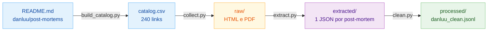

# E2.2 — Pipeline de Ingestão (danluu)

Scripts que transformam a lista de post-mortems da danluu em um arquivo de texto limpo, pronto para o RAG. Os comandos são executados no Git Bash a partir da raiz do projeto, com o ambiente virtual ativo (ver `E2_1_Ambiente_Desenvolvimento.md`). Os dados ficam em `dataset_nela/danluu-ingestion/data/`.

## Fluxo



## 0. Dependências (só na primeira vez)

```bash
pip install -r ./dataset_nela/danluu-ingestion/requirements.txt
```

## 1. Catálogo

Gera o arquivo CSV com os links dos post-mortems a partir do `README.md` do repositório [danluu/post-mortems](https://github.com/danluu/post-mortems).

```bash
python ./dataset_nela/danluu-ingestion/scripts/build_catalog.py
```

## 2. Coleta

Baixa as páginas (HTML e PDF) de cada link e grava na pasta `data/raw/`.

```bash
python ./dataset_nela/danluu-ingestion/scripts/collect.py
```

## 3. Extração

Extrai o texto das páginas e grava um JSON por post-mortem na pasta `data/extracted/`.

```bash
python ./dataset_nela/danluu-ingestion/scripts/extract.py
```

## 4. Limpeza

Remove os documentos sem texto útil e junta o resto em um único arquivo, `data/processed/danluu_clean.jsonl`.

```bash
python ./dataset_nela/danluu-ingestion/scripts/clean.py
```
