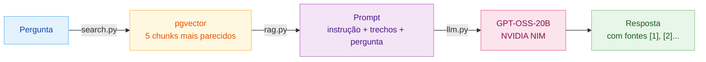

# E3.3 — Pipeline RAG End-to-End

## Fluxo



## Arquivos

| Arquivo | Papel |
|---|---|
| `dataset_nela/danluu-ingestion/scripts/search.py` | Busca os 5 chunks mais parecidos com a pergunta (E3.1) |
| `dataset_nela/danluu-ingestion/scripts/llm.py` | Envia o prompt ao GPT-OSS-20B (E3.2) |
| `dataset_nela/danluu-ingestion/scripts/rag.py` | Junta os dois: monta o prompt com os trechos encontrados e mostra a resposta com as fontes |

## Como rodar

Comandos no Git Bash a partir da raiz do projeto.

1. Abrir o Docker Desktop e subir o banco:

```bash
docker compose up -d
```

2. Ativar o ambiente virtual:

```bash
source .venv/Scripts/activate
```

3. Conferir que o `.env` tem a chave `NVIDIA_API_KEY` (ver `E3_2_Integracao_LLM.md`).

4. Fazer uma pergunta:

```bash
python dataset_nela/danluu-ingestion/scripts/rag.py "o banco de dados de produção foi apagado por engano"
```

A resposta leva de 2 a 3 minutos, quase todo o tempo esperando a NVIDIA.

## Saída

O script mostra a pergunta, a resposta da LLM, as fontes usadas e o tempo de cada etapa:

```text
Pergunta: ...

Resposta:
...

Fontes:
[1] DAN-164-000 | Gitlab | Postmortem of database outage of January 31
    similaridade 0.843 | https://about.gitlab.com/...
...

Tempo: busca ... s | LLM ... s
```
