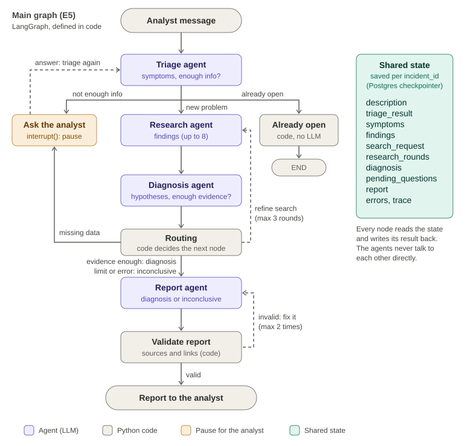

# E5 — Esboço do estado compartilhado e dos formatos dos agentes

**Situação:** proposta para a semana 5, para a equipe revisar antes de implementar. Os nomes de código estão
em inglês, como nos agentes Triagem e Pesquisa; o texto do documento, em português.

**Objetivo:** fixar o que cada agente lê e escreve, para que o Diagnóstico, o Relatório e o grafo possam ser
feitos em paralelo sem um esperar o outro.

## 1. Decisões já tomadas

| Tema | Decisão |
|---|---|
| Fluxo | o da E1.2: Triagem → Pesquisa → Diagnóstico → roteamento → Relatório, com laço de refinamento e validação do relatório |
| Agentes no grafo | cada agente entra como nó, sem ser reescrito (como o `agents/triage/node.py`) |
| Memória de curto prazo | o estado da investigação, salvo pelo checkpointer do LangGraph com `thread_id = incident_id` |
| Checkpointer | Postgres (`langgraph-checkpoint-postgres`, no mesmo banco do Docker) na demonstração e no uso normal; `InMemorySaver` nos testes automáticos |
| Memória de longo prazo | o RAG dos post-mortems (já existe) |
| Pedido de dados ao analista | `interrupt()`: o grafo pausa, salva o estado e retoma com a resposta (`Command(resume=...)`) no mesmo `incident_id` |
| Contexto entre agentes | o estado guarda só resultados estruturados; o histórico de mensagens de cada agente fica dentro dele |
| Limite de chamadas | todas as chamadas ao LLM passam pelo `rag/limite_llm.py`, inclusive as do Triagem |
| Divisão | André: Diagnóstico, estado e grafo. Mari: Relatório e validação, Triagem no grafo. Juntos: testes de integração e demonstração |

## 2. O grafo

```
START → triage ─┬─ ask_user ──────────────► ask_analyst (interrupt) ──► triage
                ├─ tell_related_incident ─► related_incident (código) ──► END
                └─ go_to_research ────────► research ──► diagnosis ─┬─ evidência suficiente ─────────► report
                                               ▲                    ├─ refinar e ainda há tentativa ─► research
                                               └────────────────────┤
                                                                    ├─ faltam dados do incidente ────► ask_analyst
                                                                    └─ refinar, sem tentativa ───────► report (inconclusivo)
report → validate_report (código) ─┬─ ok ──────────────────────────► END
                                   └─ falhou, até 2 vezes ─────────► report
```



Como ler o desenho: roxo são os agentes (usam o LLM), cinza é código Python, laranja é a pausa para o
analista e verde é o estado compartilhado. As setas tracejadas são as voltas: a resposta do analista volta ao
Triagem, o pedido de nova busca volta ao Pesquisa e o relatório inválido volta ao Relatório. Todos os nós leem
e escrevem o mesmo estado, salvo por `incident_id`.

| Nó | Tipo | Dono | O que faz |
|---|---|---|---|
| `triage` | agente | Mari | o `triage_node` atual, com os nomes do estado abaixo |
| `related_incident` | código | Mari | monta a resposta "já existe a investigação X", sem LLM |
| `research` | agente | André | chama o subgrafo do Agente Pesquisa com `description`, `symptoms` e, no refinamento, `search_request` e os achados anteriores |
| `diagnosis` | agente | André | lê os achados e escreve o `DiagnosisResult` |
| `ask_analyst` | código + `interrupt()` | André | pausa com as perguntas pendentes; ao retomar, junta a resposta à descrição e volta ao `triage` |
| `report` | agente | Mari | escreve o `Report` (diagnóstico ou inconclusivo) |
| `validate_report` | código | Mari | confere campos e fontes; se falhar, volta ao `report` com os erros |

Proposta para simplificar: o **pedido de dados** vai direto para o `ask_analyst`, com as perguntas que o
Triagem ou o Diagnóstico já escreveram, sem passar pelo Relatório. Na E1.2 o Relatório redigia o pedido; assim
economizamos uma chamada ao LLM, e as perguntas já vêm no idioma do analista. **A confirmar com a Mari.**

## 3. O estado compartilhado (`InvestigationState`)

```python
class InvestigationState(TypedDict, total=False):
    # identificação e entrada
    incident_id: str                     # = thread_id do checkpointer
    description: str                     # mensagem do analista + respostas dele, juntas (entrada do Triagem e do Pesquisa)
    analyst_answers: Annotated[list[str], operator.add]  # respostas dadas aos pedidos de dados

    # Triagem
    triage_result: TriageResult          # o resultado completo (agents/triage/schema.py)
    symptoms: list[str]                  # = triage_result.symptoms (entrada do Pesquisa)

    # Pesquisa
    findings: list[dict]                 # saída do Agente Pesquisa (formato na seção 4)
    seen_ids: list[str]                  # incidentes já vistos (o refinamento não os traz de novo)
    search_request: str                  # pedido do Diagnóstico para a próxima busca; vazio na 1ª
    research_rounds: int                 # quantas vezes o Pesquisa rodou (limite: MAX_RESEARCH_ROUNDS = 3)

    # Diagnóstico
    diagnosis: DiagnosisResult

    # pedido de dados
    pending_questions: list[str]         # perguntas enviadas ao analista no interrupt()

    # Relatório
    report: Report
    report_problems: list[str]           # erros da validação, que voltam ao Relatório
    report_attempts: int                 # limite: 2 correções

    # controle
    route: str                           # última decisão do roteamento (para o registro e a demonstração)
    errors: Annotated[list[dict], operator.add]  # {"node": ..., "error": ...}: o que falhou e onde
    trace: Annotated[list[dict], operator.add]   # {"node": ..., "seconds": ..., "summary": ...}: passo a passo
```

**Quem lê e quem escreve:**

| Campo | Escreve | Lê |
|---|---|---|
| `incident_id`, `description` | entrada / `ask_analyst` | todos |
| `triage_result`, `symptoms` | `triage` | roteamento, `research`, `diagnosis`, `report` |
| `findings`, `seen_ids`, `research_rounds` | `research` | `diagnosis`, `report`, `validate_report` |
| `search_request` | `diagnosis` | `research` |
| `diagnosis` | `diagnosis` | roteamento, `report` |
| `pending_questions` | `triage` / `diagnosis` (via roteamento) | `ask_analyst` |
| `report`, `report_problems`, `report_attempts` | `report` / `validate_report` | `validate_report`, saída final |
| `errors`, `trace` | todos | roteamento, `report`, demonstração |

## 4. Saída do Agente Pesquisa (já existe)

Cada item de `findings` (até 8, os aprofundados primeiro):

```python
{
    "incident_id": "DAN-197", "company": "Metrist", "title": "...", "url": "https://...",
    "summary": "...", "similarity": 0.66,
    "deepened": True,                    # o LLM buscou causa e correção dentro dele
    "why": "...",                        # por que o LLM o escolheu (o que bate e o que não bate)
    "passages": [                        # até 7
        {"section": "Root cause", "content": "...", "similarity": 0.61,
         "origin": "deep_search",        # ou "similar" (busca inicial)
         "query_source": "fix"},         # "llm", "cause" ou "fix" (só em deep_search)
    ],
}
```

Para o Diagnóstico, o nó `diagnosis` monta um texto mais enxuto: os incidentes aprofundados com todos os
trechos, os demais só com título e resumo (a lista completa pode passar de 60 mil caracteres).

## 5. Saída do Agente Diagnóstico (`DiagnosisResult`)

```python
class Hypothesis(BaseModel):
    cause: str                           # causa provável do incidente atual, em 1 ou 2 frases
    based_on: list[str]                  # incident_ids dos achados que sustentam a hipótese (pelo menos 1)
    matches: str                         # o que bate entre o incidente atual e os passados
    differs: str                         # o que não bate
    confidence: Literal["high", "medium", "low"]

class DiagnosisResult(BaseModel):
    hypotheses: list[Hypothesis]         # até 3, da mais à menos provável
    evidence_sufficient: bool
    gaps: list[str]                      # o que falta para ter certeza
    next_step: Literal["report", "refine_search", "ask_analyst"]
    search_request: str = ""             # obrigatório se next_step == "refine_search"
    questions_for_analyst: list[str] = []  # obrigatório se next_step == "ask_analyst" (idioma do analista)
```

**Regras de consistência** (no esquema, como no `TriageResult`):
- `evidence_sufficient` verdadeiro → `next_step == "report"` e pelo menos 1 hipótese;
- `refine_search` → `search_request` não vazio; `ask_analyst` → `questions_for_analyst` não vazio.

**Regras em código** (no nó, como no `agents/triage/agent.py`): todo `incident_id` de `based_on` tem de estar
nos `findings`; se não estiver, o erro volta ao modelo e ele corrige.

Sem confiança numérica (0–1): o livro do Dibia recomenda categorias com justificativa, porque o número
gerado pelo LLM não é calibrado.

**Ferramenta: começar sem, acrescentar se os testes mostrarem necessidade.** A primeira versão do Diagnóstico
não tem ferramenta: quando a evidência não basta, ele pede uma nova busca (`refine_search`). Se nos testes
aparecerem diagnósticos travados por falta de um detalhe de um incidente que já está nos achados, entra a
ferramenta `check_incident`:

- **O que faz:** lê mais trechos de **um incidente que já está nos `findings`**, procurando por uma pergunta.
  Exemplo: `check_incident("DAN-197", "how did they detect that Azure changed the API?")`.
- **Como:** reaproveita a busca dentro de um incidente do Pesquisa (`search_in_incident` em
  `agents/research/tools.py`): compara a pergunta com os chunks daquele post-mortem e devolve os 2 ou 3 mais
  parecidos, sem repetir os que o Diagnóstico já recebeu. Não chama o LLM; é uma consulta ao banco.
- **Limites:** só aceita incidentes dos `findings` e até 2 chamadas por diagnóstico.
- **Diferença para o `refine_search`:** a ferramenta olha **dentro** de um incidente já encontrado, para
  confirmar um detalhe (versão, gatilho, configuração alterada); o `refine_search` volta ao Pesquisa para
  achar **outros** incidentes, e custa uma rodada inteira (1 ou 2 chamadas ao LLM e um novo diagnóstico).

**E o texto completo?** O banco não guarda o post-mortem inteiro numa coluna só, mas ele pode ser remontado:
os chunks de cada incidente estão numerados na ordem do documento (`DAN-001-001`, `DAN-001-002`...), e juntá-los
devolve o texto, com pequenas repetições (o título da seção repetido no começo dos chunks de uma seção longa e
até 60 tokens de sobreposição quando um parágrafo foi dividido). O tamanho é o problema: a mediana é de ~10 mil
caracteres por incidente, 10% passam de 23 mil, e o maior tem 150 mil. Mandar o texto inteiro ao LLM gastaria
muito contexto e pesaria no limite do NIM. Por isso a ferramenta devolve trechos escolhidos pela pergunta; uma
variante "texto completo" só faria sentido com um teto de tamanho (por exemplo, até 15 mil caracteres).

**Roteamento depois do Diagnóstico (código):**

| Condição | Próximo nó |
|---|---|
| `evidence_sufficient` | `report` (diagnóstico) |
| `next_step == "ask_analyst"` | `ask_analyst` |
| `next_step == "refine_search"` e `research_rounds < MAX_RESEARCH_ROUNDS` | `research` |
| qualquer outro caso, ou erro no Diagnóstico | `report` (inconclusivo) |

## 6. Saída do Agente Relatório (`Report`)

O que a E1 pede para cada causa provável: causa raiz histórica, passos de correção, código ou configuração
alterados, checklist de prevenção, link para o post-mortem e nível de confiança.

```python
class Source(BaseModel):
    incident_id: str
    title: str
    url: str

class ReportCause(BaseModel):
    root_cause: str                      # a causa no incidente histórico e por que se aplica ao atual
    remediation_steps: list[str]         # o que foi feito para corrigir
    changes: str | None = None           # código ou configuração alterados, se o post-mortem disser
    prevention_checklist: list[str]
    sources: list[Source]                # pelo menos 1
    confidence: Literal["high", "medium", "low"]

class Report(BaseModel):
    incident_id: str
    kind: Literal["diagnosis", "inconclusive"]
    summary: str                         # 2 a 3 frases para o analista
    causes: list[ReportCause]            # pelo menos 1 em "diagnosis"; pode ser vazio em "inconclusive"
    gaps: list[str]                      # obrigatório em "inconclusive"
    suggested_checks: list[str]          # o que o analista pode verificar agora
```

O relatório sai no idioma do analista, como as perguntas do Triagem.

**Validação em código (`validate_report`):**
- todo `incident_id` das fontes existe nos `findings`, e o `url` é o mesmo dos `findings` (o modelo não
  inventa link);
- `diagnosis` tem pelo menos 1 causa, e cada causa tem pelo menos 1 fonte;
- `inconclusive` tem pelo menos 1 lacuna.

Se falhar, os problemas vão para `report_problems` e o Relatório tenta de novo (até 2 vezes). Se ainda falhar,
o código monta um relatório inconclusivo com os achados e as lacunas, para o fluxo nunca terminar sem resposta.

## 7. Pausa e retomada (`interrupt()`)

```python
def ask_analyst(state):
    answer = interrupt({"incident_id": state["incident_id"], "questions": state["pending_questions"]})
    return {"description": state["description"] + "\n\nAnalyst answer: " + answer,
            "analyst_answers": [answer], "pending_questions": []}
```

- O nó **roda de novo do começo** quando o grafo é retomado, por isso não há nada caro (chamada ao LLM) antes
  do `interrupt()`.
- Retomar: `graph.invoke(Command(resume=resposta), {"configurable": {"thread_id": incident_id}})`.
- Com o Postgres, a pausa sobrevive ao fim do programa: o analista pode responder depois, em outra execução.

## 8. Tratamento de erros

| Situação | O que acontece |
|---|---|
| erro passageiro do NIM (tempo esgotado, 429, 5xx) | `limite_llm` espera e tenta de novo; o nó tem `RetryPolicy` |
| agente esgota as tentativas | o nó grava o erro em `errors` e o roteamento segue para o `report` inconclusivo |
| resposta fora do formato | o erro volta ao modelo dentro do agente (como no Triagem e no Pesquisa) |
| relatório inválido | volta ao `report` até 2 vezes; depois, relatório inconclusivo montado em código |
| laço de refinamento | no máximo `MAX_RESEARCH_ROUNDS = 3` rodadas do Pesquisa (1ª + 2 refinamentos) |

## 9. Onde fica o código

```
agents/
  triage/          (existe)  node.py com os nomes do estado em inglês
  research/        (existe)  node.py novo: research_node
  diagnosis/       (novo)    agent.py, prompts.py, schema.py, node.py, tests/, doc
  report/          (novo)    agent.py, prompts.py, schema.py, validate.py, node.py, tests/, doc
  orchestration/   (novo)    state.py, graph.py, run.py (demonstração), tests/ (integração)
```

## 10. Testes de integração (5.5)

Com `InMemorySaver` e, quando possível, agentes falsos (como o `agents/triage/tests/test_node.py`), além de
algumas rodadas com o modelo real:

1. problema novo com caso parecido no corpus → relatório de diagnóstico com fontes válidas;
2. mensagem vaga → pausa com perguntas; retomada com a resposta → segue até o relatório;
3. duplicado → resposta com o `incident_id`, sem chamar o Pesquisa;
4. problema fora do corpus → refinamento até o limite → relatório inconclusivo;
5. refinamento que melhora a evidência: o incidente certo aparece na 2ª busca;
6. retomada em outra execução (Postgres), com o mesmo `incident_id`;
7. falha do LLM ou resposta inválida → o fluxo não quebra e termina com relatório inconclusivo;
8. relatório com link inventado → a validação rejeita e o Relatório corrige.

## 11. Pontos para a equipe confirmar

**Decididos (23/11):**
- o Diagnóstico começa sem ferramenta; a `check_incident` entra só se os testes mostrarem necessidade (seção 5);
- `MAX_RESEARCH_ROUNDS = 3` e até 2 correções do relatório;
- o relatório sai no idioma do analista.

**Para a Mari confirmar:**
1. O pedido de dados vai direto ao `ask_analyst`, sem o Relatório (seção 2).
2. Os nomes do estado (seção 3): o `node.py` do Triagem passa a usar `description` e `symptoms`.

## 12. Resumo simples

**O que é este documento:** um contrato entre as partes. Ele combina o que cada agente recebe e o que entrega,
para que cada um possa construir a sua parte sem esperar a do outro. Como cada agente funciona por dentro
(prompt, ferramentas, número de chamadas) fica a critério de quem o faz.

**Como os agentes se comunicam:** eles não conversam entre si. Existe uma "pasta da investigação" (o estado
compartilhado) que passa de mão em mão. Cada agente lê dela o que precisa, faz o seu trabalho e escreve o
resultado de volta. Depois de cada agente, um trecho de código olha a pasta e decide quem trabalha em seguida.
A pasta fica salva no banco, identificada pelo número do incidente; por isso a investigação pode parar e
continuar depois.

**O caminho de uma investigação:**
1. O analista descreve o problema.
2. O **Triagem** separa os sintomas. Se falta informação, o sistema pausa e pergunta ao analista; quando ele
   responde, o Triagem lê de novo. Se o problema já está sendo investigado, o sistema avisa e termina.
3. O **Pesquisa** encontra incidentes passados parecidos e os trechos de causa e correção.
4. O **Diagnóstico** propõe as causas mais prováveis e diz se a evidência basta. Se não basta, pode pedir uma
   nova busca (no máximo 3 rodadas) ou perguntar ao analista.
5. O **Relatório** escreve a resposta final: o diagnóstico, com causa, correção, prevenção e links dos
   post-mortems, ou um relatório inconclusivo, explicando o que faltou.
6. Um código confere o relatório (os links existem? cada causa tem fonte?). Se algo estiver errado, o
   Relatório corrige.

**Se algo der errado:** o erro fica registrado, e o sistema termina com um relatório inconclusivo. Ele nunca
fica sem resposta.

**Quem faz o quê:** André faz o Diagnóstico, o estado e o grafo; Mari faz o Relatório com a validação e liga o
Triagem ao grafo; os dois fazem juntos os testes de integração e a demonstração.

**O que falta combinar:** os 2 pontos da seção 11 que dependem da Mari.
